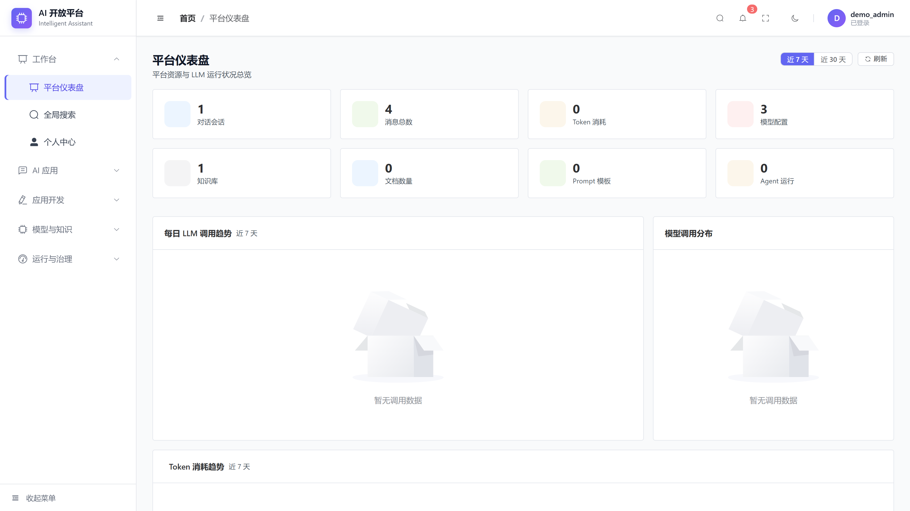

<p align="center">
  
</p>

<h1 align="center">尚枢 AI · ShangShu AI</h1>

<p align="center">
  <strong>纯 Java 技术栈的自托管 AI 应用平台</strong><br />
  多模型接入 · 知识库 RAG · Agent 工作流 · 智能客服 · 安全治理，一套可部署、可扩展、可运营的系统
</p>

<p align="center">
  <a href="https://github.com/jiangjiangbozan/ShangShu-AI/actions/workflows/ci.yml"></a>
  <a href="LICENSE"></a>
  
  
  
  <a href="https://github.com/jiangjiangbozan/ShangShu-AI/pulls"></a>
  <a href="https://github.com/jiangjiangbozan/ShangShu-AI/discussions"></a>
</p>

<p align="center">
  <a href="README_EN.md">English</a> ·
  <a href="#-快速开始">快速开始</a> ·
  <a href="#-评测与基准">评测数据</a> ·
  <a href="#-文档">文档</a> ·
  <a href="#-roadmap">Roadmap</a> ·
  <a href="#-贡献与社区">参与贡献</a>
</p>

<p align="center">
  
</p>

---

## 目录

- [为什么是尚枢 AI](#为什么是尚枢-ai)
- [功能特性](#-功能特性)
- [界面预览](#-界面预览)
- [技术栈与架构](#-技术栈与架构)
- [快速开始](#-快速开始)
- [Docker 部署](#-docker-部署)
- [关键配置](#-关键配置)
- [评测与基准](#-评测与基准)
- [Roadmap](#-roadmap)
- [文档](#-文档)
- [贡献与社区](#-贡献与社区)
- [许可证](#-许可证)

---

## 为什么是尚枢 AI

大多数 AI 应用框架以 Python 为主，Java 团队要么被迫引入异构技术栈，要么只能拼装零散组件。尚枢 AI 用**一套纯 Java 工程体系**把完整的 AI 应用能力串起来：

- **Spring AI 原生**：模型接入、Embedding、VectorStore 全部走 Spring AI 抽象，向量化后端可在本地 Ollama 与云端百炼之间一键切换（同为 768 维，切换后用 `reembed.py` 原地重算）
- **RAG 全链路可评测**：QueryRewrite → 语义 / 关键词 / 父文档 / 知识图谱四路召回 → RRF 融合 → 精排 → 引用来源。**50 题基准 Recall@5 0.960、命中率 96%**，所有指标都能在仓库里复现
- **工程化开箱即用**：Flyway 迁移、JWT + RBAC + CSRF + XSS、RabbitMQ 异步、Redis Stack 会话、Prometheus 指标、Docker Compose 一键起
- **多端一致体验**：Vue 3 管理台、Android（Compose）、uni-app 小程序

> 首次访问 Web 端会先展示公开落地页（平台介绍、能力清单与开源仓库入口），无需注册即可浏览；登录后进入控制台。

---

## ✨ 功能特性

| 模块 | 能力 |
| --- | --- |
| **多模型管理** | DeepSeek / 通义千问 / Ollama 统一接入，`sys_model_config` 动态热建客户端，连通性测试，路由与降级 |
| **知识库 RAG** | 文档解析切片、多路召回、RRF、Rerank、反馈闭环、Redis 命中缓存、检索链路逐步展开调试 |
| **Agent** | ReAct / Function Calling 双策略引擎，工具注册与调用，执行轨迹追踪 |
| **可视化工作流** | 20 种节点执行器，Dify 风格画布（小地图 / 自定义边），DAG 执行，SSE 实时推送，节点级重试 |
| **智能客服** | 意图识别、槽位填充、澄清模板、状态机对话管理、知识库兜底 |
| **课程知识问答** | RAG 问答场景：QueryRewrite + 多路检索 + 引用来源 |
| **平台安全** | JWT 双 Token、CSRF Double-Submit、XSS Filter、RBAC、Jasypt 字段加密 |
| **可观测** | TraceId 全链路、对话日志、LLM 调用统计、Prometheus、Actuator |
| **多端** | Vue 3 管理台 · Android（Kotlin + Compose）· uni-app 小程序 |

<details>
<summary><b>工作流节点一览（20 种）</b></summary>

`Start` · `End` · `LLM` · `IfElse` · `Loop` · `Iteration` · `KnowledgeRetrieval` · `QuestionClassifier` · `Agent` · `Code` · `HttpRequest` · `Tool` · `HumanInput` · `VariableAssigner` · `VariableAggregator` · `TemplateTransform` · `ParameterExtractor` · `ListFilter` · `DocExtractor` · `Answer`

使用文档见 [docs/workflow-nodes.md](docs/workflow-nodes.md)，扩展指南见 [docs/workflow-node-spi.md](docs/workflow-node-spi.md)，官方模板见 [docs/workflow-templates/](docs/workflow-templates/)。

</details>

---

## 📸 界面预览

### 知识库 RAG



> 多路召回结果逐步展开：原 query、改写 query、各召回通道耗时、RRF 融合、精排分数与最终引用来源。

---

## 🏗 技术栈与架构

| 层 | 技术 |
| --- | --- |
| 后端 | Java 21 · Spring Boot 4.1 · Spring AI 2.0 · Spring Security 7 · MyBatis-Plus 3.5 · Flyway · Redisson 4 |
| 中间件 | MySQL 8 · Redis 7 Stack（RediSearch）· Elasticsearch 9 · RabbitMQ 3.13 |
| Web | Vue 3 · TypeScript · Vite · Element Plus · Pinia · Vue Flow · ECharts |
| 移动端 | Kotlin · Jetpack Compose · Retrofit |
| 基础设施 | Docker Compose · Nginx · p6spy · Spotless · Checkstyle · GitHub Actions |

> **版本说明**：Spring Boot 4.1 / Spring AI 2.0 当前使用里程碑版；ES 9 与 Spring Data Elasticsearch 6.0 客户端协议对齐；Redis Stack 含 RediSearch（`FT._LIST` 是 Spring AI ChatMemory 的依赖）。

```
ai/
├── api/                       # 后端服务（Spring Boot + Spring AI）
│   └── src/main/java/com/ai/api/
│       ├── agent/             # Agent 运行时：ReAct / FC 引擎、工具注册、执行追踪
│       ├── workflow/          # 工作流引擎：20 种 NodeExecutor、DAG 执行器
│       ├── knowledge/         # RAG：解析、切片、多路检索、RRF、Rerank
│       ├── chat/              # 对话：SSE 流式、会话管理、ES 搜索索引
│       ├── cs/                # 智能客服：意图、槽位、澄清、状态机
│       ├── model/             # 模型管理：动态加载、连通性、路由降级
│       ├── identity/          # JWT、OAuth2、RBAC、API Key
│       ├── data/              # MyBatis-Plus、RabbitMQ、Redis
│       ├── audit/ · common/   # 审计、统一响应、TraceId、CORS
│       └── ...                # 完整模块见 api/AGENTS.md
├── ai-agent-web/              # Web 管理台（Vue 3 + Element Plus + Vue Flow）
├── ai-agent-client/           # Android（Kotlin + Compose）
├── ai-agent-mini/             # 小程序（uni-app）
├── dev/                       # 评测与语料工具（RAG 评测集、抓取、重嵌入、标定）
├── docs/                      # 架构、评测报告、开发日志、模板
├── docker-compose.yml         # 中间件 / API / Web 编排
└── .env.example               # 环境变量模板
```

---

## 🚀 快速开始

**依赖**：Docker + JDK 21 + Node 22+ + Maven 3.9+

```bash
# 1. 启动中间件（MySQL / Redis Stack / ES / RabbitMQ）
docker compose up -d

# 2. 启动后端（零配置：application-dev.yml 默认值已与 Compose 对齐）
cd api
mvn spring-boot:run -Dspring-boot.run.profiles=dev
# Swagger:   http://localhost:8080/swagger-ui.html
# 健康检查:  http://localhost:8080/actuator/health

# 3. 启动 Web 端
cd ai-agent-web
npm install
npm run dev
# 访问: http://localhost:5173
```

**验证清单**：

- `curl http://localhost:8080/actuator/health` 返回 `{"status":"UP"}`
- 打开 `http://localhost:5173` 能看到落地页，注册登录后进入仪表盘
- 新建知识库上传一份 Markdown，能在「检索测试」里看到向量/关键词/RRF/精排各阶段结果

> **端口冲突**：宿主机 3306 被本地 MySQL 占用时，可 `MYSQL_HOST_PORT=3307 docker compose up -d`，启动后端时加 `MYSQL_PORT=3307`。

---

## 🐳 Docker 部署

```bash
cp .env.example .env
# 完整部署至少需要 AI_AUTH_JWT_SECRET 与 JASYPT_ENCRYPTOR_PASSWORD（api 强制校验）

docker compose --profile full up -d --build
# API: http://localhost:8080
# Web: http://localhost
```

| 命令 | 启动的服务 |
| --- | --- |
| `docker compose up -d` | MySQL · Redis Stack · Elasticsearch · RabbitMQ（仅中间件） |
| `docker compose --profile full up -d --build` | 中间件 + API + Web（完整部署） |

> 生产部署前务必修改：`AI_AUTH_JWT_SECRET`（≥32 字符随机串）、`JASYPT_ENCRYPTOR_PASSWORD`、`MYSQL_ROOT_PASSWORD`、`MYSQL_PASSWORD`、`REDIS_PASSWORD`、`RABBITMQ_PASSWORD`，并配置至少一个可用的模型 API Key。

---

## ⚙️ 关键配置

### 模型接入

模型统一在 `sys_model_config` 表配置（provider / model_id / base_url / api_key），`ChatClientFactory` 按 modelId 动态热建客户端；`api_key` 支持加密列（`api_key_encrypted`，Jasypt）与明文列两种写法。

### RAG 向量化与精排

```yaml
# 向量化：默认百炼，可切本地 Ollama
rag:
  embedding:
    provider: dashscope   # dashscope | ollama
# 精排：默认开启，失败自动回退 RRF 原序
  rerank:
    enabled: true
    protocol: dashscope
    model: qwen3.7-text-rerank
```

密钥三种注入方式，优先级从高到低：环境变量 `DASHSCOPE_API_KEY` → `api/src/main/resources/application-secret.yml`（gitignore）→ 空值。

> 想完全离线：设 `RAG_EMBEDDING_PROVIDER=ollama` 并 `ollama pull nomic-embed-text`。两者同为 768 维，切换后需用 `dev/rag-eval/reembed.py` 重嵌入全部分片，否则语义检索失效。

### 知识库命中门控

`cs.kb-hit-threshold` 默认 **0.4**，取值来自 215 题次 rerank 判别力标定的结论（详见 [rerank-calibration-report.md](docs/platform/testing/rerank-calibration-report.md)）。

---

## 📊 评测与基准

所有数字均可在仓库中复现，数据集、脚本与报告都在 `dev/` 和 `docs/platform/testing/`。

### 知识库资产

| 知识库 | 文档 | 切片 | token | 来源 |
| --- | --- | --- | --- | --- |
| kb1 测试知识库 | 2 | 70 | 12,486 | 编译原理实验报告（评测基准库） |
| kb3 技术文档库 | 27 | 338 | 56,170 | 项目自文档 |
| kb4 官方技术文档库 | 33 | 747 | 122,968 | Spring AI / MyBatis-Plus / Elasticsearch / RabbitMQ 官方仓库 |
| kb5 中文技术文档库 | 193 | 2,024 | 353,565 | Kubernetes 中文官方文档（CC BY 4.0） |
| **合计** | **255** | **3,179** | **545,189** | MySQL 与 ES 向量数完全对账 |

### 检索质量（kb1 · 50 题基准）

| 配置 | Recall@5 | MRR | nDCG@5 | 命中率 | 单次精排 token |
| --- | --- | --- | --- | --- | --- |
| RRF 无精排 | 0.780 | 0.491 | 0.563 | — | 0 |
| **+ Rerank（800 字截断）** | **0.960** | **0.857** | **0.884** | **96%** | **5,210** |

> 800 字截断相比 1,200 字：token 省 32%，指标反升（0.940 → 0.960）。详见 [rag-eval-slim-report.md](docs/platform/testing/rag-eval-slim-report.md)。

### Rerank 判别力标定（215 题次独立实验）

| 门控阈值 | 正例保留率 | 负例误放率 |
| --- | --- | --- |
| 0.3 | 85.5–87.5% | 5.6–6.6% |
| **0.4（当前默认）** | **80–84%** | **2.1–2.8%** |
| 0.5 | 74.5–75.0% | 0.6–1.0% |
| 0.6 | 61.8–63.7% | 0–0.3% |

> 判别力：5 个候选时正例 top1 率 92.5%，10 候选 91.2%，15 候选 87.3%。阈值 0.5 会丢掉约 1/4 的正例——这是早期中文语料「精排负增益」的真正原因。详见 [rerank-calibration-report.md](docs/platform/testing/rerank-calibration-report.md)。

### 语料增强（离线生成，已回填数据库）

255 篇文档均生成摘要 + 5 个关键词 + 3 组问答对（共 1,275 个关键词、765 组 QA），可在文档详情中直接查看；`qa_json` 可直接用于评测集冷启动。详见 [corpus-enrichment-report.md](docs/platform/testing/corpus-enrichment-report.md)。

---

## 🗺 Roadmap

- [x] 多模型接入 + 动态加载 + 连通性测试
- [x] 知识库 RAG 全链路（QueryRewrite / 多路召回 / RRF / Rerank / 引用）
- [x] RAG 检索评测体系（数据集 + Recall/MRR/nDCG 报告 + 精排阈值标定）
- [x] 可视化工作流引擎（20 种 NodeExecutor + DAG + SSE 推送）
- [x] Agent ReAct / Function Calling 双策略引擎
- [x] AI 应用发布与 API Key 统一调用（OpenAI 兼容协议）
- [x] 工作流执行记录持久化 + 前端 DAG 执行视图
- [x] Prompt 版本管理 · 工作流版本控制 · 节点级重试 · 并行分支
- [x] 语料增强（摘要 / 关键词 / 问答对）与文档详情展示
- [ ] 多模态语料：文档配图理解（VL 图注 → 图文检索）
- [ ] 语音链路：STT / TTS 接入（`VoiceService` 已预留 OpenAI 兼容接口）
- [ ] Web 管理台深色模式（GFI-3）
- [ ] 知识图谱召回增强与增量索引
- [ ] 单测覆盖率提升至 60%

---

## 📚 文档

| 文档 | 路径 |
| --- | --- |
| 架构说明 | [docs/platform/architecture.md](docs/platform/architecture.md) |
| 知识库语料统计 | [docs/platform/testing/knowledge-base-corpus.md](docs/platform/testing/knowledge-base-corpus.md) |
| RAG 评测报告（50 题 / 800 字） | [docs/platform/testing/rag-eval-slim-report.md](docs/platform/testing/rag-eval-slim-report.md) |
| 中文语料评测（80 题） | [docs/platform/testing/rag-eval-kb5-report.md](docs/platform/testing/rag-eval-kb5-report.md) |
| Rerank 判别力标定 | [docs/platform/testing/rerank-calibration-report.md](docs/platform/testing/rerank-calibration-report.md) |
| 语料增强报告 | [docs/platform/testing/corpus-enrichment-report.md](docs/platform/testing/corpus-enrichment-report.md) |
| 工作流节点使用 / 扩展 | [docs/workflow-nodes.md](docs/workflow-nodes.md) · [docs/workflow-node-spi.md](docs/workflow-node-spi.md) |

---

## 🤝 贡献与社区

- **参与贡献**：[CONTRIBUTING.md](CONTRIBUTING.md)（环境准备 · 代码规范 · PR 流程）
- **新人任务**：[Good First Issues](docs/good-first-issues.md)（标注了验收标准的入门任务）
- **安全漏洞**：请勿公开提交，按 [SECURITY.md](SECURITY.md) 私密报告
- **发布记录**：[Release Notes](docs/release-notes/)（当前 v0.1.0）
- **问题交流**：[GitHub Discussions](https://github.com/jiangjiangbozan/ShangShu-AI/discussions)

如果这个项目对你有帮助，欢迎点一个 ⭐ Star。

---

## 许可证

[Apache License 2.0](LICENSE)

---

## ⭐ Star History

<a href="https://star-history.com/#jiangjiangbozan/ShangShu-AI&Date">
  
</a>
