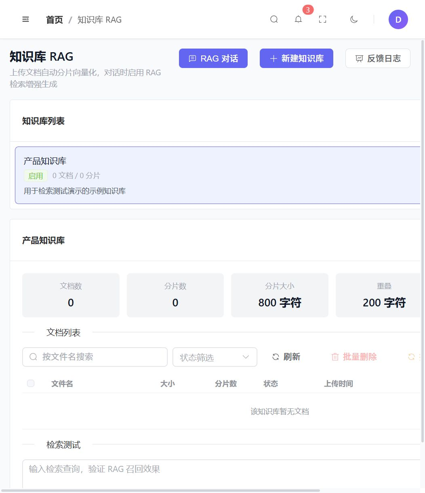

<p align="center">
  <h1 align="center">尚枢 AI · ShangShu AI</h1>
  <p align="center">面向 Java / Spring Boot 团队的自托管 AI 应用平台</p>
</p>

<p align="center">
  <a href="README_EN.md">English</a> ·
  <a href="https://www.oracle.com/java/technologies/downloads/#java21">Java 21</a> ·
  <a href="https://spring.io/projects/spring-boot">Spring Boot 4.1</a> ·
  <a href="https://spring.io/projects/spring-ai">Spring AI</a> ·
  <a href="https://element-plus.org">Element Plus</a> ·
  <a href="https://vueflow.dev">Vue Flow</a>
</p>

---

> 首次访问 Web 端会先展示**公开落地页**（平台介绍、能力清单与开源仓库入口），无需注册即可浏览；登录后再进入控制台。

尚枢 AI（ShangShu AI）是一个**纯 Java 技术栈**的自托管 AI 应用平台。基于 Spring AI 构建，将多模型接入、企业知识库 RAG、可视化 Agent 工作流、运行观测与安全治理整合到一套可部署、可扩展、可运营的系统中。

- **Spring AI 原生**：模型接入、Embedding、VectorStore 全部走 Spring AI 抽象，不锁死供应商
- **完整 RAG 链路**：QueryRewrite → 向量 + 关键词双路召回 → RRF 融合 → Rerank → Parent Document → 知识图谱抽取
- **可扩展工作流引擎**：20 种节点执行器，DAG 拓扑执行，变量上下文，条件分支，SSE 实时推送
- **工程化开箱即用**：Flyway 数据库迁移、JWT + RBAC + CSRF + XSS 安全体系、RabbitMQ 异步架构、Redis Stack 会话持久化

---

## 功能特性

| 模块             | 能力                                                                       |
| ---------------- | -------------------------------------------------------------------------- |
| **多模型管理**   | DeepSeek / 通义 / Ollama 等统一接入，动态加载，连通性测试，路由与降级      |
| **知识库 RAG**   | 文档解析切片、多路召回、RRF、Rerank、反馈闭环、Redis 命中缓存              |
| **Agent**        | ReAct / Function Calling 双策略引擎，工具注册与调用，执行轨迹追踪          |
| **可视化工作流** | 20 种节点，Dify 风格编排器，节点画布 / 小地图 / 自定义边，SSE 运行时推送   |
| **智能客服**     | 意图识别、槽位填充、澄清模板、状态机对话管理、知识库兜底                   |
| **课程知识问答** | RAG 问答场景，QueryRewrite + 多路检索 + 引用来源                           |
| **平台安全**     | JWT 双 Token、CSRF Double-Submit、XSS Filter、RBAC 权限、Jasypt 加密       |
| **可观测**       | TraceId 全链路、对话日志、LLM 调用统计、Prometheus 指标、Actuator 健康检查 |
| **多端**         | Vue 3 管理台、Android、uni-app 小程序                                      |

### 工作流节点一览（20 种）

Start · End · LLM · IfElse · Loop · Iteration · KnowledgeRetrieval · QuestionClassifier · Agent · Code · HttpRequest · Tool · HumanInput · VariableAssigner · VariableAggregator · TemplateTransform · ParameterExtractor · ListFilter · DocExtractor · Answer

---

## 技术栈

| 层       | 技术                                                                                               |
| -------- | -------------------------------------------------------------------------------------------------- |
| 后端     | Java 21 · Spring Boot 4.1 · Spring AI · Spring Security 7 · MyBatis-Plus 3.5 · Flyway · Redisson 4 |
| 中间件   | MySQL 8 · Redis 7 Stack（含 RediSearch） · Elasticsearch 9 · RabbitMQ 3.13                         |
| Web      | Vue 3 · TypeScript · Vite · Element Plus · Pinia · Vue Flow · ECharts                              |
| 移动端   | Kotlin · Jetpack Compose · Retrofit                                                                |
| 基础设施 | Docker Compose · Nginx · p6spy · Spotless · Checkstyle                                             |

> **版本说明**：Spring Boot 4.1 / Spring AI 当前使用里程碑版；ES 9 与 Spring Data Elasticsearch 6.0 客户端协议对齐；Redis Stack 含 RediSearch 模块（`FT._LIST` 命令是 Spring AI ChatMemory 的依赖）。

---

## 界面截图

### 平台仪表盘



### 知识库 RAG


---

## 仓库结构

```
ai/
├── api/                       # 后端服务（Spring Boot + Spring AI）
│   └── src/main/java/com/ai/api/
│       ├── agent/             # Agent 运行时：ReAct / FC 引擎、工具注册、执行追踪
│       ├── workflow/          # 可视化工作流引擎：20 种 NodeExecutor、DAG 执行器
│       ├── knowledge/         # 知识库 RAG：文档解析、切片、多路检索、RRF、Rerank
│       ├── chat/              # 对话：SSE 流式输出、会话管理、ES 搜索索引
│       ├── cs/                # 智能客服：意图识别、槽位填充、澄清模板、状态机
│       ├── course/            # 课程知识问答：RAG 问答场景
│       ├── model/             # 模型管理：动态加载、连通性测试、路由降级
│       ├── identity/          # 身份认证：JWT、OAuth2、RBAC、API Key
│       ├── data/              # 基础设施：MyBatis-Plus 配置、RabbitMQ、Redis
│       ├── audit/             # 操作审计
│       ├── common/            # 通用层：统一响应、异常、TraceId、CORS
│       └── ...                # 完整模块见 AGENTS.md
├── ai-agent-web/              # Web 管理台（Vue 3 + Element Plus + Vue Flow）
├── ai-agent-client/           # Android 移动端（Kotlin + Jetpack Compose）
├── ai-agent-mini/             # 小程序端（uni-app）
├── docker-compose.yml         # Docker Compose（中间件 / API / Web）
├── .env.example               # 环境变量模板（复制为 .env 使用）
└── docs/                      # 开发日志、规范文档
```

---

## 快速开始

### 模式 A：本地开发（推荐）

依赖：Docker + JDK 21 + Node 22+ + Maven 3.9+

```bash
# 1. 启动中间件（MySQL / Redis / ES / RabbitMQ）
docker compose up -d

# 2. 启动后端（零配置：application-dev.yml 默认值已与 Compose 对齐）
cd api
mvn spring-boot:run -Dspring-boot.run.profiles=dev
# Swagger:  http://localhost:8080/swagger-ui.html
# 健康检查: http://localhost:8080/actuator/health

# 3. 启动 Web 端
cd ai-agent-web
npm install
npm run dev
# 访问: http://localhost:5173
```

> **说明**：
>
> - 本地开发**无需复制 .env**。开发默认值（MySQL `ai_agent/ai_agent_123`、Redis、RabbitMQ 等）已与 docker-compose.yml 对齐；`mvn spring-boot:run` 不会自动读取 `.env`，需要覆盖配置时请通过 IDE 环境变量或启动参数注入
> - 若宿主机 3306 已被本地 MySQL 占用，两种解法任选：
>   ① 停掉本地服务（如 `Stop-Service MySQL80`）再 `docker compose up -d`；
>   ② 切换端口：`MYSQL_HOST_PORT=3307 docker compose up -d`，启动后端时加 `MYSQL_PORT=3307`

> **RAG 功能额外依赖**：向量默认走 Ollama `nomic-embed-text`，需要本机安装 Ollama 并拉取模型：
>
> ```bash
> ollama pull nomic-embed-text
> ```
>
> 只测试 Chat / Agent / Workflow 功能不需要这一步；RAG 检索与知识库向量化必须先有 Embedding 模型（或在 `.env` / 环境变量中改配其他 Embedding 方案）。

### 模式 B：Docker 完整部署

```bash
cp .env.example .env
# .env 中已是开箱可用的开发默认值；完整部署至少需要其中的
# AI_AUTH_JWT_SECRET 与 JASYPT_ENCRYPTOR_PASSWORD 两项（api 服务强制校验）

# 一键启动（中间件 + API + Web）
docker compose --profile full up -d --build

# API:  http://localhost:8080
# Web:  http://localhost
```

> **生产部署前**务必：
>
> - 修改 `AI_AUTH_JWT_SECRET` 为至少 32 字符的随机字符串
> - 修改 `JASYPT_ENCRYPTOR_PASSWORD` 为强密码
> - 修改 `MYSQL_ROOT_PASSWORD`、`MYSQL_PASSWORD` 和 `REDIS_PASSWORD`
> - 修改 `RABBITMQ_PASSWORD`（默认 Admin@123456，需与 api 服务一致）
> - 设置至少一个可用的模型 API Key（`DEEPSEEK_API_KEY` / `QWEN_API_KEY` 等）

### Docker Compose Profile 说明

| 命令                                          | 启动的服务                                                    |
| --------------------------------------------- | ------------------------------------------------------------- |
| `docker compose up -d`                        | MySQL · Redis Stack · Elasticsearch · RabbitMQ（中间件 only） |
| `docker compose --profile full up -d --build` | 上述中间件 + API + Web（完整部署）                            |

> Ollama 不在 Compose 中编排（Compose 服务定义已注释保留）：RAG Embedding 默认连接宿主机 Ollama（`localhost:11434`），Windows/macOS 桌面版或本机服务均可，无需容器化。

---

## 后端 API 文档

- Swagger UI：启动后访问 `http://localhost:8080/swagger-ui.html`
- Actuator：`/actuator/health` · `/actuator/prometheus`

---

## 文档

| 文档                        | 路径                            |
| --------------------------- | ------------------------------- |
| 架构说明                    | `docs/platform/architecture.md` |
| 开发日志                    | `docs/dev-log/`                 |
| RAG 检索评测报告            | `docs/rag-eval-report.md`       |
| 工作流节点扩展指南          | `docs/workflow-node-spi.md`     |
| 工作流节点使用文档（20 种） | `docs/workflow-nodes.md`        |
| 官方工作流模板              | `docs/workflow-templates/`      |
| 技术文章                    | `docs/articles/`                |
| 后端开发约定                | `api/AGENTS.md`                 |
| 前端开发约定                | `ai-agent-web/AGENTS.md`        |
| 通用开发原则                | `AGENTS.md`                     |

## 社区

- **参与贡献**：[CONTRIBUTING.md](CONTRIBUTING.md)（环境准备 · 代码规范 · PR 流程）
- **新人任务**：[Good First Issues](docs/good-first-issues.md)（5 个标注了验收标准的入门任务）
- **安全漏洞**：请勿公开提交，按 [SECURITY.md](SECURITY.md) 私密报告
- **发布记录**：[Release Notes](docs/release-notes/)（当前版本 v0.1.0）
- **问题交流**：[GitHub Discussions](https://github.com/jiangjiangbozan/ShangShu-AI/discussions)

---

## 许可证

Apache License 2.0

---

## Roadmap

- [x] 多模型接入 + 动态加载 + 连通性测试
- [x] 知识库 RAG 检索链路（多路召回 + RRF + Rerank + QueryRewrite）
- [x] 可视化工作流引擎（20 种 NodeExecutor + DAG 执行器）
- [x] Agent ReAct / Function Calling 双策略引擎
- [x] JWT + RBAC + CSRF + XSS 安全体系
- [x] AI 应用发布与 API Key 统一调用（chat / rag / agent / workflow 四类型，OpenAI 兼容协议）
- [x] 工作流执行记录持久化 + 前端 DAG 执行视图
- [x] RAG 检索测试页面（逐步展开链路）
- [x] Prompt 版本管理
- [x] 工作流版本控制 + 节点级重试 + 并行分支
- [x] RAG 检索评测数据集与对比报告（50 题数据集 + Recall/MRR/nDCG）
- [x] 工作流节点使用文档（[docs/workflow-nodes.md](docs/workflow-nodes.md)，GFI-2）
- [ ] Web 管理台深色模式（GFI-3）
- [x] 示例工作流模板库（[docs/workflow-templates/](docs/workflow-templates/)，GFI-4）
- [x] 英文版 README（[README_EN.md](README_EN.md)，GFI-5）
