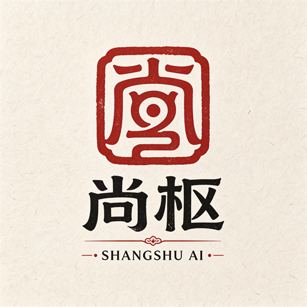
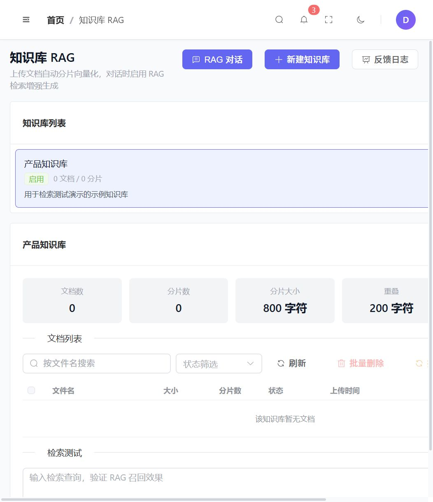
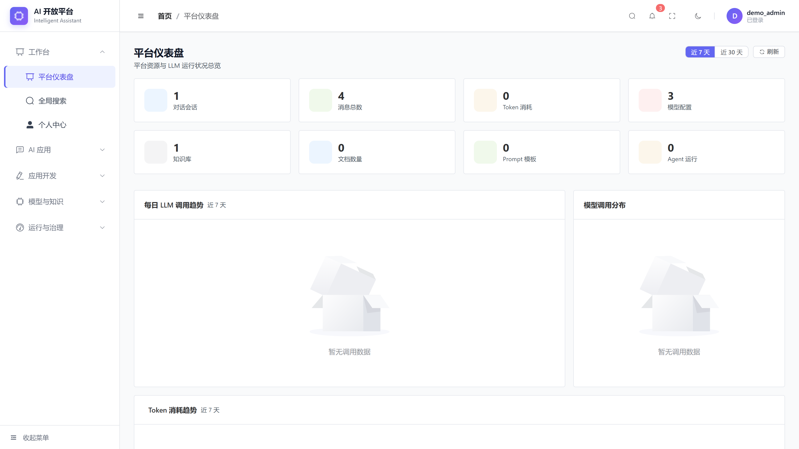

<p align="center">
  
</p>

<p align="center">
  <h1 align="center">ShangShu AI · 尚枢 AI</h1>
  <p align="center">A self-hosted AI application platform for Java / Spring Boot teams</p>
</p>

<p align="center">
  <a href="README.md">中文</a> ·
  <a href="https://github.com/jiangjiangbozan/ShangShu-AI/actions"></a>
</p>

<p align="center">
  <a href="https://www.oracle.com/java/technologies/downloads/#java21">Java 21</a> ·
  <a href="https://spring.io/projects/spring-boot">Spring Boot 4.1</a> ·
  <a href="https://spring.io/projects/spring-ai">Spring AI</a> ·
  <a href="https://element-plus.org">Element Plus</a> ·
  <a href="https://vueflow.dev">Vue Flow</a>
</p>

---

> The landing page of this repository is served without login: open the web console and the public
> home page introduces the platform, its capabilities and the open-source repository before you
> decide to sign up.

ShangShu AI is a **pure Java stack** self-hosted AI application platform. Built on Spring AI, it
brings multi-model access, enterprise knowledge-base RAG, visual Agent workflows, runtime
observability and security governance into one deployable, extensible and operable system.

- **Spring AI native**: model access, embeddings and vector stores all go through Spring AI
  abstractions; the embedding backend can be switched by configuration between local Ollama and Bailian
- **Complete RAG pipeline**: QueryRewrite → semantic / keyword / parent-document / knowledge-graph
  four-path recall → RRF fusion → Bailian Rerank → cited sources (50-question eval: Recall@5 0.940,
  94% hit rate)
- **Extensible workflow engine**: 20 node executors, DAG topology execution, variable context,
  conditional branches and real-time SSE push
- **Production ready out of the box**: Flyway migrations, JWT + RBAC + CSRF + XSS security stack,
  RabbitMQ asynchronous architecture, Redis Stack session persistence

---

## Features

| Module                     | Capability                                                                                                        |
| -------------------------- | ----------------------------------------------------------------------------------------------------------------- |
| **Multi-model management** | Unified access to DeepSeek / Qwen / Ollama, dynamic loading, connectivity tests, routing and fallback             |
| **Knowledge base RAG**     | Document parsing and chunking, four-path recall, RRF, Bailian Rerank, feedback loop, Redis hit cache              |
| **Agent**                  | Dual-strategy engine (ReAct / Function Calling), tool registry and invocation, execution trace                    |
| **Visual workflow**        | 20 node types, Dify-style editor, canvas / minimap / custom edges, SSE runtime push                               |
| **Customer service**       | Intent recognition, slot filling, clarification templates, state-machine dialogue, knowledge-base fallback        |
| **Course Q&A**             | RAG Q&A scenario with QueryRewrite, multi-path retrieval and cited sources                                        |
| **Platform security**      | Dual JWT tokens, CSRF double-submit, XSS filter, RBAC permissions, Jasypt encryption                              |
| **Observability**          | TraceId across the full chain, conversation logs, LLM call statistics, Prometheus metrics, Actuator health checks |
| **Multi-platform**         | Vue 3 admin console, Android client, uni-app mini program                                                         |

### Workflow node catalogue (20 types)

Start · End · LLM · IfElse · Loop · Iteration · KnowledgeRetrieval · QuestionClassifier · Agent ·
Code · HttpRequest · Tool · HumanInput · VariableAssigner · VariableAggregator ·
TemplateTransform · ParameterExtractor · ListFilter · DocExtractor · Answer

---

## Tech stack

| Layer          | Technology                                                                                         |
| -------------- | -------------------------------------------------------------------------------------------------- |
| Backend        | Java 21 · Spring Boot 4.1 · Spring AI · Spring Security 7 · MyBatis-Plus 3.5 · Flyway · Redisson 4 |
| Middleware     | MySQL 8 · Redis 7 Stack (with RediSearch) · Elasticsearch 9 · RabbitMQ 3.13                        |
| Web            | Vue 3 · TypeScript · Vite · Element Plus · Pinia · Vue Flow · ECharts                              |
| Mobile         | Kotlin · Jetpack Compose · Retrofit                                                                |
| Infrastructure | Docker Compose · Nginx · p6spy · Spotless · Checkstyle                                             |

> **Version note**: Spring Boot 4.1 and Spring AI are pinned to GA releases; the Elasticsearch 9
> client protocol matches Spring Data Elasticsearch 6.0; Redis Stack ships the RediSearch module
> (`FT._LIST` is required by the Spring AI ChatMemory implementation).

---

## Repository layout

```
ai/
├── api/                       # Backend service (Spring Boot + Spring AI)
│   └── src/main/java/com/ai/api/
│       ├── agent/             # Agent runtime: ReAct / FC engines, tool registry, execution trace
│       ├── workflow/          # Visual workflow engine: 20 NodeExecutors, DAG executor
│       ├── knowledge/         # Knowledge base RAG: parsing, chunking, multi-path retrieval, RRF, Rerank
│       ├── chat/              # Chat: SSE streaming, session management, ES search index
│       ├── cs/                # Customer service: intent, slot filling, clarification, state machine
│       ├── course/            # Course knowledge Q&A scenario
│       ├── model/             # Model management: dynamic loading, connectivity tests, routing fallback
│       ├── identity/          # Identity: JWT, OAuth2, RBAC, API Key
│       ├── data/              # Infrastructure: MyBatis-Plus config, RabbitMQ, Redis
│       ├── audit/             # Operation audit
│       ├── common/            # Shared layer: unified response, exceptions, TraceId, CORS
│       └── ...                # See AGENTS.md for the full module list
├── ai-agent-web/              # Web admin console (Vue 3 + Element Plus + Vue Flow)
├── ai-agent-client/           # Android client (Kotlin + Jetpack Compose)
├── ai-agent-mini/             # Mini program client (uni-app)
├── docker-compose.yml         # Docker Compose (middleware / API / Web)
├── .env.example               # Environment variable template (copy to .env)
└── docs/                      # Development logs, specs and documents
```

---

## Quick start

### Mode A: local development (recommended)

Requirements: Docker + JDK 21 + Node 22+ + Maven 3.9+

```bash
# 1. Start middleware (MySQL / Redis / ES / RabbitMQ)
docker compose up -d

# 2. Start backend (zero configuration: application-dev.yml defaults match Compose)
cd api
mvn spring-boot:run -Dspring-boot.run.profiles=dev
# Swagger:  http://localhost:8080/swagger-ui.html
# Health:   http://localhost:8080/actuator/health

# 3. Start the web console
cd ai-agent-web
npm install
npm run dev
# Open: http://localhost:5173
```

> **Notes**:
>
> - **No `.env` needed for local development.** The defaults (MySQL `ai_agent` / `ai_agent_123`,
>   Redis, RabbitMQ, …) already match `docker-compose.yml`. `mvn spring-boot:run` does not read
>   `.env`; inject environment variables through your IDE or the run configuration instead.
> - If port 3306 is already taken by a local MySQL, pick either:
>   ① stop the local service (e.g. `Stop-Service MySQL80`) then run `docker compose up -d`;
>   ② switch the port: `MYSQL_HOST_PORT=3307 docker compose up -d`, and start the backend with
>   `MYSQL_PORT=3307`.

> **Extra dependency for RAG**: embeddings default to Bailian `qwen3.7-text-embedding-flash`
> (OpenAI-compatible endpoint, 768 dims), so an API key is required:
>
> ```bash
> # option 1: environment variable
> export DASHSCOPE_API_KEY=sk-xxx
>
> # option 2: local secret file (git-ignored, never committed)
> # api/src/main/resources/application-secret.yml
> # dashscope:
> #   api-key: sk-xxx
> ```
>
> For a fully offline setup, switch back to local Ollama with `RAG_EMBEDDING_PROVIDER=ollama` and
> `ollama pull nomic-embed-text`. Both produce 768 dims; after switching you must re-embed all
> chunks via `dev/rag-eval/reembed.py`, otherwise semantic retrieval breaks.
>
> Rerank also runs on Bailian and is enabled by default; disabling it or a failed call falls back to
> the RRF order automatically.
>
> This step is only required for RAG retrieval and knowledge-base vectorization. Testing Chat / Agent
> / Workflow does not need it.

### Mode B: full Docker deployment

```bash
cp .env.example .env
# .env already ships working development defaults; a full deployment requires at least
# AI_AUTH_JWT_SECRET and JASYPT_ENCRYPTOR_PASSWORD (the API service validates them)

# Start everything (middleware + API + Web)
docker compose --profile full up -d --build

# API:  http://localhost:8080
# Web:  http://localhost
```

> **Before going to production** make sure to:
>
> - Replace `AI_AUTH_JWT_SECRET` with a random string of at least 32 characters
> - Replace `JASYPT_ENCRYPTOR_PASSWORD` with a strong password
> - Replace `MYSQL_ROOT_PASSWORD`, `MYSQL_PASSWORD` and `REDIS_PASSWORD`
> - Replace `RABBITMQ_PASSWORD` (default `Admin@123456`, must match the API service)
> - Configure at least one usable model API key (`DEEPSEEK_API_KEY` / `QWEN_API_KEY`, …)

### Docker Compose profiles

| Command                                       | Services started                                                 |
| --------------------------------------------- | ---------------------------------------------------------------- |
| `docker compose up -d`                        | MySQL · Redis Stack · Elasticsearch · RabbitMQ (middleware only) |
| `docker compose --profile full up -d --build` | The above plus API and Web (full deployment)                     |

> Ollama is not orchestrated by Compose (its service definition is kept but commented out): RAG
> embeddings connect to the host Ollama instance (`localhost:11434`) by default, so the native
> Windows/macOS desktop app or a host service works without containerisation.

---

## Screenshots

### Platform dashboard



### Knowledge base RAG



---

## Backend API

- Swagger UI: `http://localhost:8080/swagger-ui.html` after startup
- Actuator: `/actuator/health` · `/actuator/prometheus`

---

## Documentation

Most documents are written in Chinese.

| Document                        | Path                            |
| ------------------------------- | ------------------------------- |
| Architecture                    | `docs/platform/architecture.md` |
| Development log                 | `docs/dev-log/`                 |
| RAG retrieval evaluation report | `docs/rag-eval-report.md`       |
| Workflow node extension guide   | `docs/workflow-node-spi.md`     |
| Workflow node usage (20 types)  | `docs/workflow-nodes.md`        |
| Official workflow templates     | `docs/workflow-templates/`      |
| Technical articles              | `docs/articles/`                |
| Backend conventions             | `api/AGENTS.md`                 |
| Frontend conventions            | `ai-agent-web/AGENTS.md`        |
| General development principles  | `AGENTS.md`                     |

## Community

- **Contribute**: [CONTRIBUTING.md](CONTRIBUTING.md) (environment setup · code style · PR flow)
- **Good first issues**: [Good First Issues](docs/good-first-issues.md) (5 beginner tasks with acceptance criteria)
- **Security vulnerabilities**: please report privately, do not open a public issue — see [SECURITY.md](SECURITY.md)
- **Release notes**: [Release Notes](docs/release-notes/) (current version v0.1.0)
- **Discussions**: [GitHub Discussions](https://github.com/jiangjiangbozan/ShangShu-AI/discussions)

---

## License

Apache License 2.0

---

## Roadmap

- [x] Multi-model access + dynamic loading + connectivity tests
- [x] Knowledge base RAG retrieval pipeline (hybrid recall + RRF + Rerank + QueryRewrite)
- [x] Visual workflow engine (20 NodeExecutors + DAG executor)
- [x] Agent ReAct / Function Calling dual-strategy engine
- [x] JWT + RBAC + CSRF + XSS security stack
- [x] AI application publishing and unified API Key invocation (chat / rag / agent / workflow, OpenAI-compatible protocol)
- [x] Workflow run persistence + front-end DAG execution view
- [x] RAG retrieval test page (step-by-step pipeline expansion)
- [x] Prompt version management
- [x] Workflow versioning + node-level retry + parallel branches
- [x] RAG retrieval evaluation dataset and comparison report (50-question dataset + Recall / MRR / nDCG)
- [x] English README
- [ ] Dark mode for the web console
- [ ] Example workflow template library expansion
