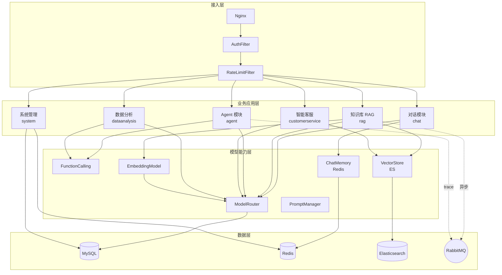
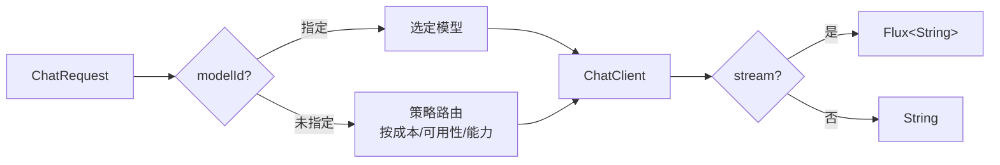
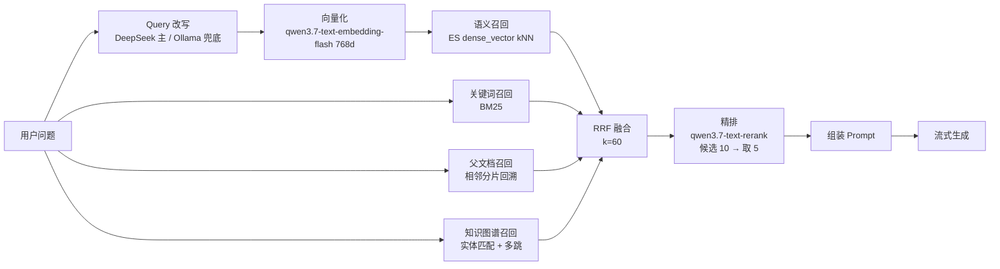
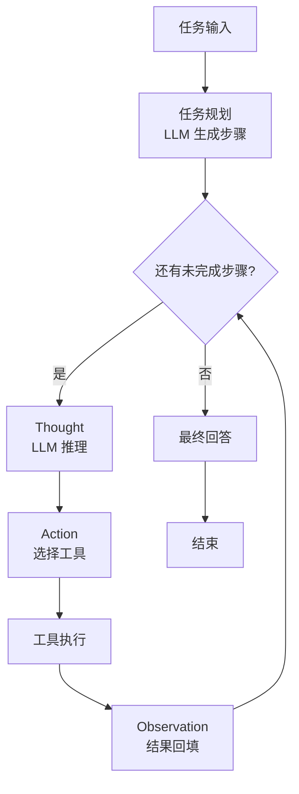

# 架构设计文档 - 尚枢 AI · ShangShu AI

> **版本**：v1.2（对齐 v0.1.0：Spring Boot 4.1 / Spring AI 2.0 GA、工作流版本化与执行记录、AI 应用四类型发布、RAG 评测链路）
> **更新日期**：2026-11-20
> **关联**：[development-plan.md](./development-plan.md)、[coding-standards.md](../standards/coding-standards.md)

---

## 1. 总体架构

### 1.1 分层架构

```
┌──────────────────────────────────────────────────────────────────────┐
│                        接入层 (Access Layer)                          │
│  Nginx (反向代理 + SSE/WebSocket 长连接) + Filter (鉴权/限流/日志)     │
└──────────────────────────────────────────────────────────────────────┘
                                ↓
┌──────────────────────────────────────────────────────────────────────┐
│                    业务应用层 (Business Layer)                        │
│ ┌─────────┬─────────┬──────────┬──────────┬──────────┬──────────┐   │
│ │ 对话    │ RAG     │ Agent    │ 智能客服 │ 数据分析 │ 系统管理 │   │
│ │ Chat    │         │ ReAct    │          │ NL2SQL   │ RBAC     │   │
│ └─────────┴─────────┴──────────┴──────────┴──────────┴──────────┘   │
└──────────────────────────────────────────────────────────────────────┘
                                ↓
┌──────────────────────────────────────────────────────────────────────┐
│                    模型能力层 (Model Layer)                           │
│ ModelRouter (多模型路由) + PromptManager + FunctionCalling            │
│ ChatMemory (基于 Redis) + VectorStore (基于 ES) + EmbeddingModel      │
└──────────────────────────────────────────────────────────────────────┘
                                ↓
┌──────────────────────────────────────────────────────────────────────┐
│                      数据层 (Data Layer)                              │
│ MySQL (业务/会话/知识库元数据) + Redis (缓存/会话/限流/分布式锁)         │
│ Elasticsearch (向量检索 + 全文检索) + RabbitMQ (异步任务/日志)         │
│ MinIO (对象存储：文档原文件/导出报告)                                  │
└──────────────────────────────────────────────────────────────────────┘
```

### 1.2 部署架构

```
                    ┌─────────────┐
                    │   用户浏览器  │
                    └──────┬──────┘
                           │ HTTPS
                    ┌──────▼──────┐
                    │   Nginx     │  ← 反向代理 + 静态资源 + SSE 长连接
                    └──────┬──────┘
            ┌──────────────┼──────────────┐
            │              │              │
     ┌──────▼──────┐ ┌─────▼─────┐ ┌─────▼─────┐
     │ ai-agent-web│ │   api     │ │ ai-agent-web│
     │  (前端静态) │ │(Spring Boot│  (前端静态) │
     │             │ │+SkyWalking│             │
     │             │ │  Agent)   │             │
     └─────────────┘ └─────┬─────┘ └─────────────┘
                            │
   ┌────────┬────────┬──────┴───┬────────┬────────┬────────┐
   │        │        │          │        │        │        │
┌──▼──┐ ┌──▼──┐ ┌───▼───┐ ┌───▼───┐ ┌──▼──┐ ┌───▼────┐ ┌─▼─────┐
│MySQL│ │Redis│ │  ES   │ │RabbitMQ│ │MinIO│ │Ollama  │ │外部LLM│
└─────┘ └─────┘ └───────┘ └───────┘ └─────┘ └────────┘ └──────┘
                                                   (DeepSeek/通义千问 API)

  可观测性侧车：SkyWalking OAP │ Prometheus+Grafana │ Sentry（可选）
```

---

## 2. 技术栈

### 2.1 后端（基于 `api/` 现状）

| 类别 | 选型 | 版本 | 说明 |
|------|------|------|------|
| 语言 | Java | 21 LTS | 已配置 |
| 框架 | Spring Boot | 4.1.0 | 已配置 |
| AI 框架 | Spring AI | 2.0.0 | 已配置 |
| Web | spring-boot-starter-webmvc | - | 已引入 |
| 数据库 | MySQL | 8.0 | mysql-connector-j 已引入 |
| 缓存 | Redis | 7.x | spring-boot-starter-data-redis 已引入 |
| 搜索 | Elasticsearch | 8.x | spring-boot-starter-data-elasticsearch 已引入 |
| 消息队列 | RabbitMQ | 3.13 | spring-boot-starter-amqp 已引入 |
| 校验 | spring-boot-starter-validation | - | 已引入 |
| Lombok | Lombok | - | 已引入 |
| Spring AI 组件 | chat-memory-repository-redis | 2.0.0 | 已引入，会话记忆 |
| Spring AI 组件 | stability-ai | 2.0.0 | 已引入，图像生成（可选使用） |
| Spring AI 组件 | vector-store-elasticsearch | 2.0.0 | 已引入，向量存储 |
| Spring AI 组件 | vector-store-advisor | 2.0.0 | 已引入，RAG advisor |
| 待引入 | spring-ai-starter-model-deepseek | 2.0.0 | DeepSeek 接入（M2） |
| 待引入 | spring-ai-starter-model-qwen | 2.0.0 | 通义千问接入（M2） |
| 待引入 | spring-ai-starter-model-ollama | 2.0.0 | 本地 Ollama（M2） |
| 待引入 | MyBatis-Plus | 3.5.x | ORM（M1） |
| 待引入 | Flyway | 10.x | 数据库迁移（M1） |
| 待引入 | Sa-Token | 1.39+ | 认证授权框架，替代 Spring Security（M0 迁移） |
| 待引入 | Redisson | 4.x（含 redisson-spring-data-41） | 分布式锁、限流（RRateLimiter）、会话管理（M0） |
| 待引入 | Knife4j | 4.x | API 文档增强（基于 springdoc-openapi），离线导出（M0） |
| 待引入 | XXL-Job | 2.4+ | 分布式定时任务调度（M0 部署，M2 业务接入） |
| 待引入 | MinIO SDK | 8.x | 对象存储客户端，文档/报告/头像存储（M0） |

### 2.2 前端（已存在于 `ai-agent-web/`）

| 类别 | 选型 | 说明 |
|------|------|------|
| 框架 | Vue 3.5 + TypeScript | 已配置 |
| 构建 | Vite 8.x | 已配置 |
| UI | Element Plus 2.14 | 已引入 |
| 状态 | Pinia 4.x | 已引入 |
| 路由 | Vue Router 5.x | 已引入 |
| HTTP | axios 1.19 | 已引入 |
| SSE | @microsoft/fetch-event-source 2.0.1 | 已引入 |
| Markdown | marked 18 | 已引入 |
| Lint | ESLint 10 + oxlint 1.73 | 已配置 |
| 格式化 | Prettier 3.9 | 已配置 |

### 2.3 基础设施

| 类别 | 选型 | 说明 |
|------|------|------|
| 容器 | Docker + Docker Compose | 一键编排所有服务 |
| 反向代理 | Nginx | SSE 长连接关键配置（proxy_buffering off / read_timeout 300s） |
| 对象存储 | MinIO | 文档原文件、导出报告、头像等非结构化数据 |
| APM 链路追踪 | SkyWalking | 全链路 Trace（HTTP/MQ/DB/LLM），M4 全链路接入 |
| 指标监控 | Prometheus + Grafana | 系统指标 + 业务指标，M6 接入 |
| 错误追踪 | Sentry（可选） | 前后端异常采集与告警，M6 接入 |
| 日志聚合 | Loki + Promtail | 应用日志聚合 |
| CI | GitHub Actions / GitLab CI | lint + test + build |

---

## 3. 模块划分

### 3.1 模块全景图



### 3.2 模块职责

| 模块 | 子包 | 职责 | 依赖 |
|------|------|------|------|
| **common** | `com.ai.api.common` | 通用 DTO、异常、常量、工具、Result 包装 | 无 |
| **data** | `com.ai.api.data` | Entity、Mapper、Redis 操作、ES 操作、MQ 生产消费 | common |
| **model** | `com.ai.api.model` | ModelRouter、PromptManager、FunctionCalling、统一模型抽象 | data |
| **chat** | `com.ai.api.chat` | 会话管理、上下文、Token 计数、SSE 流式输出 | model、data |
| **rag** | `com.ai.api.rag` | 文档解析、分块、向量化、混合检索、问答生成 | model、data |
| **agent** | `com.ai.api.agent` | ReactEngine、ToolRegistry、任务规划、工具集 | model、data |
| **customerservice** | `com.ai.api.customerservice` | 意图识别、槽位填充、多轮对话、知识匹配 | model、rag、data |
| **dataanalysis** | `com.ai.api.dataanalysis` | NL2SQL、数据可视化、报告生成 | model、agent（工具） |
| **system** | `com.ai.api.system` | 用户、权限（RBAC）、配置、日志、限流 | data |

### 3.3 关键依赖关系
- `chat` 是其他模块的基础（提供会话与 SSE 能力）
- `rag` 提供 `VectorStore` 封装给 `customerservice` 使用
- `agent` 的工具集可被 `dataanalysis` 复用（NL2SQL 作为工具）
- `model` 是所有 LLM 调用的统一入口，禁止业务层直接调用 Spring AI Client

---

## 4. 核心数据模型

### 4.1 MySQL 表（按模块）

#### chat 模块
```sql
-- 会话
CREATE TABLE chat_session (
  id BIGINT PRIMARY KEY AUTO_INCREMENT,
  session_id VARCHAR(64) NOT NULL UNIQUE COMMENT '会话ID(UUID)',
  user_id BIGINT NOT NULL,
  title VARCHAR(255) COMMENT '会话标题',
  model_id VARCHAR(64) COMMENT '使用的模型ID',
  system_prompt TEXT COMMENT '系统提示词',
  context_window INT DEFAULT 10 COMMENT '上下文窗口消息数',
  total_tokens INT DEFAULT 0 COMMENT '累计Token',
  status TINYINT DEFAULT 1 COMMENT '1:active 0:archived',
  created_at DATETIME DEFAULT CURRENT_TIMESTAMP,
  updated_at DATETIME DEFAULT CURRENT_TIMESTAMP ON UPDATE CURRENT_TIMESTAMP,
  deleted TINYINT DEFAULT 0,
  INDEX idx_user_id (user_id),
  INDEX idx_created_at (created_at)
);

-- 消息
CREATE TABLE chat_message (
  id BIGINT PRIMARY KEY AUTO_INCREMENT,
  session_id VARCHAR(64) NOT NULL,
  role VARCHAR(16) NOT NULL COMMENT 'user/assistant/system/tool',
  content MEDIUMTEXT,
  tokens INT DEFAULT 0,
  model_id VARCHAR(64),
  tools_used JSON COMMENT '工具调用记录',
  latency_ms INT COMMENT '响应延迟',
  created_at DATETIME DEFAULT CURRENT_TIMESTAMP,
  INDEX idx_session (session_id, created_at)
);
```

#### rag 模块
```sql
-- 知识库
CREATE TABLE kb_knowledge_base (
  id BIGINT PRIMARY KEY AUTO_INCREMENT,
  name VARCHAR(128) NOT NULL,
  description TEXT,
  embedding_model VARCHAR(64),
  chunk_size INT DEFAULT 500,
  chunk_overlap INT DEFAULT 50,
  owner_id BIGINT,
  created_at DATETIME DEFAULT CURRENT_TIMESTAMP,
  updated_at DATETIME DEFAULT CURRENT_TIMESTAMP ON UPDATE CURRENT_TIMESTAMP,
  deleted TINYINT DEFAULT 0
);

-- 文档
CREATE TABLE kb_document (
  id BIGINT PRIMARY KEY AUTO_INCREMENT,
  kb_id BIGINT NOT NULL,
  file_name VARCHAR(255) NOT NULL,
  file_type VARCHAR(32),
  file_size BIGINT,
  file_path VARCHAR(512),
  status TINYINT DEFAULT 0 COMMENT '0:pending 1:parsing 2:chunked 3:vectorized 4:failed',
  chunk_count INT DEFAULT 0,
  error_msg TEXT,
  created_at DATETIME DEFAULT CURRENT_TIMESTAMP,
  updated_at DATETIME DEFAULT CURRENT_TIMESTAMP ON UPDATE CURRENT_TIMESTAMP,
  INDEX idx_kb (kb_id, status)
);

-- 文本块
CREATE TABLE kb_chunk (
  id BIGINT PRIMARY KEY AUTO_INCREMENT,
  document_id BIGINT NOT NULL,
  kb_id BIGINT NOT NULL,
  content TEXT NOT NULL,
  chunk_index INT,
  token_count INT,
  es_doc_id VARCHAR(64) COMMENT 'ES 中对应文档ID',
  created_at DATETIME DEFAULT CURRENT_TIMESTAMP,
  INDEX idx_doc (document_id)
);
```

#### agent 模块
```sql
-- Agent 定义
CREATE TABLE agent_def (
  id BIGINT PRIMARY KEY AUTO_INCREMENT,
  name VARCHAR(128) NOT NULL,
  description TEXT,
  system_prompt TEXT,
  tools JSON COMMENT '工具列表',
  max_iterations INT DEFAULT 10,
  model_id VARCHAR(64),
  owner_id BIGINT,
  created_at DATETIME DEFAULT CURRENT_TIMESTAMP,
  updated_at DATETIME DEFAULT CURRENT_TIMESTAMP ON UPDATE CURRENT_TIMESTAMP,
  deleted TINYINT DEFAULT 0
);

-- Agent 执行记录
CREATE TABLE agent_task (
  id BIGINT PRIMARY KEY AUTO_INCREMENT,
  agent_id BIGINT NOT NULL,
  session_id VARCHAR(64),
  input TEXT,
  plan TEXT COMMENT '任务规划(JSON)',
  status TINYINT DEFAULT 0 COMMENT '0:running 1:success 2:failed',
  trace_id VARCHAR(64),
  total_tokens INT DEFAULT 0,
  latency_ms INT,
  error_msg TEXT,
  created_at DATETIME DEFAULT CURRENT_TIMESTAMP,
  INDEX idx_agent (agent_id, created_at)
);

-- 工具调用 trace
CREATE TABLE agent_tool_trace (
  id BIGINT PRIMARY KEY AUTO_INCREMENT,
  task_id BIGINT NOT NULL,
  iteration INT,
  thought TEXT,
  action VARCHAR(64),
  action_input JSON,
  observation TEXT,
  latency_ms INT,
  created_at DATETIME DEFAULT CURRENT_TIMESTAMP,
  INDEX idx_task (task_id, iteration)
);
```

#### system 模块
```sql
-- 用户
CREATE TABLE sys_user (
  id BIGINT PRIMARY KEY AUTO_INCREMENT,
  username VARCHAR(64) NOT NULL UNIQUE,
  password VARCHAR(255),
  nickname VARCHAR(64),
  email VARCHAR(128),
  phone VARCHAR(32),
  status TINYINT DEFAULT 1,
  last_login_at DATETIME,
  created_at DATETIME DEFAULT CURRENT_TIMESTAMP,
  updated_at DATETIME DEFAULT CURRENT_TIMESTAMP ON UPDATE CURRENT_TIMESTAMP,
  deleted TINYINT DEFAULT 0
);

-- 角色、权限、用户角色关联、角色权限关联（RBAC 标准表）
-- 配置表、操作日志表、LLM 调用日志表（略，详见 M1 design）
```

### 4.2 Redis 键策略

| Key 模式 | 类型 | TTL | 用途 |
|---------|------|-----|------|
| `chat:ctx:<sessionId>` | String(JSON) | 1h | 会话上下文缓存（与 chat-memory-repository-redis 配合） |
| `chat:token:<userId>` | Hash | 1d | 用户 Token 用量 |
| `ratelimit:<userId>:<endpoint>` | String(计数) | 1min | 接口限流 |
| `config:model` | Hash | 持久 | 模型配置热更新 |
| `session:user:<userId>` | String | 30min | 用户会话(JWT) |
| `lock:agent:task:<taskId>` | String | 5min | Agent 任务幂等锁 |

### 4.3 Elasticsearch 索引

#### 知识库向量索引 `ai_agent_knowledge`

全库共用单索引，靠 `metadata.knowledgeBaseId` 做知识库隔离，避免按库建索引带来的 mapping 漂移。

```json
{
  "mappings": {
    "properties": {
      "id": { "type": "text", "fields": { "keyword": { "type": "keyword", "ignore_above": 256 } } },
      "content": { "type": "text", "fields": { "keyword": { "type": "keyword", "ignore_above": 256 } } },
      "embedding": {
        "type": "dense_vector",
        "dims": 768,
        "index": true,
        "similarity": "cosine",
        "index_options": { "type": "int8_hnsw", "m": 16, "ef_construction": 100 }
      },
      "metadata": {
        "properties": {
          "documentId": { "type": "text", "fields": { "keyword": { "type": "keyword", "ignore_above": 256 } } },
          "knowledgeBaseId": { "type": "text", "fields": { "keyword": { "type": "keyword", "ignore_above": 256 } } }
        }
      }
    }
  }
}
```

> **维度必须与向量模型一致**：当前落地为百炼 `qwen3.7-text-embedding-flash`（768 维，`dimensions` 支持 768/512/256）。历史本地后端 `nomic-embed-text` 同样是 768 维，因此切换模型无需重建索引，但**必须原地重算全部分片向量**（`dev/rag-eval/reembed.py`，按 `_id` 更新、保留 chunk id）。若改维度，需删除索引重建并全量重嵌入。
>
> `int8_hnsw` 量化把向量内存占用压到 float32 的约 1/4，召回损失在 768 维余弦场景下可忽略（实测切换前后 RRF Recall 0.780 → 0.940，见 `docs/platform/testing/rag-eval-report.md`）。

### 4.4 RabbitMQ 队列

| Exchange | 类型 | Queue | Routing Key | 用途 |
|----------|------|-------|-------------|------|
| `ai.doc.parse` | direct | `q.doc.parse` | `parse` | 文档异步解析 |
| `ai.doc.vector` | direct | `q.doc.vector` | `vector` | 异步向量化 |
| `ai.agent.trace` | topic | `q.agent.trace` | `agent.trace.#` | Agent 执行 trace |
| `ai.llm.log` | topic | `q.llm.log` | `llm.log.#` | LLM 调用日志 |
| `ai.dead` | fanout | `q.dead` | - | 死信队列 |

---

## 5. 接口规范

### 5.1 REST API 总览

| 模块 | 路径前缀 | 主要接口 |
|------|---------|---------|
| chat | `/api/v1/chat/sessions`、`/api/v1/chat/messages/stream` | 会话 CRUD、SSE 流式 |
| rag | `/api/v1/kb/knowledge-bases`、`/api/v1/kb/documents`、`/api/v1/kb/qa` | 知识库 CRUD、上传、问答 |
| agent | `/api/v1/agent/agents`、`/api/v1/agent/tasks/stream` | Agent 配置、任务流式执行 |
| customerservice | `/api/v1/cs/intent`、`/api/v1/cs/dialog` | 意图识别、多轮对话 |
| dataanalysis | `/api/v1/da/query`、`/api/v1/da/chart` | NL2SQL、图表 |
| system | `/api/v1/sys/users`、`/api/v1/sys/configs`、`/api/v1/sys/logs` | 用户、配置、日志 |

### 5.2 SSE 流式接口规范

```
POST /api/v1/chat/messages/stream
Content-Type: application/json
Accept: text/event-stream
Authorization: Bearer <jwt>

{
  "sessionId": "uuid-xxx",
  "content": "你好",
  "modelId": "deepseek-chat"
}
```

响应：
```
event: message
data: {"delta":"你","messageId":"msg-xxx"}

event: message
data: {"delta":"好","messageId":"msg-xxx"}

event: tool_call
data: {"tool":"weather","input":{...}}   // Agent 模式下

event: done
data: {"messageId":"msg-xxx","totalTokens":25,"latencyMs":800}
```

### 5.3 内部 SPI

```java
// 模型能力层对外暴露
public interface ModelRouter {
    Flux<String> streamChat(ChatRequest request);
    String chat(ChatRequest request);
    EmbeddingResult embed(String text);
}

public interface PromptManager {
    String render(String templateId, Map<String, Object> vars);
}

// RAG 模块对外暴露
public interface RagService {
    Flux<String> streamAnswer(String kbId, String question);
    List<Chunk> search(String kbId, String query, int topK);
}

// Agent 模块对外暴露
public interface AgentExecutor {
    Flux<AgentEvent> execute(AgentRequest request);
}
```

---

## 6. 关键技术决策

### 6.1 多模型路由（ModelRouter）



**实现要点**：
- 使用 Spring AI 的 `ChatClient` 抽象，各模型通过 starter 接入
- `ModelRouter` 维护模型注册表（从 DB 或配置加载）
- 支持 fallback：主模型不可用自动切换备用
- 所有调用记录到 `llm_log` 表（异步通过 MQ）

### 6.2 对话上下文管理

**方案**：使用 Spring AI 已引入的 `chat-memory-repository-redis`。

```
ChatClient.builder()
    .defaultAdvisors(
        MessageChatMemoryAdvisor.builder(chatMemoryRepository).build(),
        VectorStoreChatMemoryAdvisor.builder(vectorStore).build()
    )
```

- 短期记忆：Redis（已配置）
- 长期记忆：MySQL `chat_message` 表，会话结束异步持久化
- Token 计数：使用模型 API 返回的 usage，缓存到 Redis Hash

### 6.3 RAG 混合检索



**落地要点**

| 环节 | 实现 | 配置项 |
|---|---|---|
| Query 改写 | 主 DeepSeek、兜底本地 Ollama qwen3:8b；短查询（<6 字符）不改写 | `rag.query-rewrite.*` |
| 向量化 | 百炼 OpenAI 兼容端点，单批 20 条、768 维；`@Primary` Bean 覆盖 Ollama | `rag.embedding.*` |
| 四路召回 | `semantic,fulltext,parent,knowledge_graph`，各路独立 topK 后融合 | `rag.retrieval-methods` |
| 融合 | RRF（k=60），连字符自动归一化为下划线 | `rag.query-rewrite.rrf-k` |
| 精排 | 百炼原生 rerank 协议，候选 10 条取前 5，分数回写 metadata 供下游门控 | `rag.rerank.*` |
| 降级 | rerank 关闭或调用失败自动回退 RRF 原序；客服 KB 命中阈值取 rerank 分数 0.4（判别力标定结论） | `cs.kb-hit-threshold` |

> 实测（50 题中文数据集）：四路召回 + RRF 达 Recall@5 0.940 / nDCG@5 0.794，再叠加 rerank 后 nDCG@5 0.870、命中率 94%。指标与演进对比见 `docs/platform/testing/rag-eval-report.md`。

### 6.4 Agent ReAct 引擎



**关键点**：
- 使用 Spring AI 的 Function Calling 机制，封装为 ReAct 循环
- `ToolRegistry` 注解式发现工具（`@ToolRegistry`）
- 每轮迭代记录 trace（thought/action/observation）到 `agent_tool_trace`
- 最大迭代次数限制（默认 10）+ 超时熔断

### 6.5 工具集设计

| 工具 | 类名 | 实现要点 |
|------|------|---------|
| 计算器 | `CalculatorTool` | 表达式解析（不使用 eval，用 exp4j） |
| 天气查询 | `WeatherTool` | 调用 OpenWeather / 和风天气 API |
| NL2SQL | `NL2SqlTool` | 基于 schema 提示，LLM 生成 SQL → 执行 → 返回结果 |
| 网络搜索 | `WebSearchTool` | Tavily / SerpAPI / Bing API |
| 代码执行 | `CodeExecTool` | 沙箱：Docker 容器执行 Python/JS（限制网络与资源） |

---

## 7. 安全设计

### 7.1 鉴权
- JWT（Access Token + Refresh Token）
- Access Token 有效期 30 分钟，Refresh Token 7 天
- 密码：BCrypt

### 7.2 权限
- RBAC：用户 - 角色 - 权限
- 接口级：`@PreAuthorize("hasAuthority('chat:session:create')")`
- 数据级：知识库、Agent 按 owner_id 隔离

### 7.3 限流
- 接口级：基于 Redis 计数（令牌桶）
- 用户级：LLM 调用按 tokens/min 限制
- IP 级：防刷

### 7.4 输入安全
- 参数校验：`@Valid` + JSR-303
- SQL 注入：MyBatis 参数化 + NL2SQL 结果二次校验
- XSS：前端输出转义（marked 默认启用 sanitize）
- Prompt 注入：系统提示词前置 + 输入过滤

---

## 8. 可观测性

### 8.1 日志
- 应用日志：SLF4J + Logback，输出 JSON
- 业务日志：操作日志表 + LLM 调用日志表
- 聚合：Loki + Promtail

### 8.2 指标（Prometheus）
- `ai_chat_messages_total{model, status}`
- `ai_llm_tokens_total{model, type:prompt|completion}`
- `ai_llm_latency_seconds{model}`
- `ai_rag_search_latency_seconds`
- `ai_agent_iterations{agent_id}`

### 8.3 Trace（SkyWalking APM）
- **SkyWalking Java Agent**：自动埋点 HTTP / MySQL / Redis / RabbitMQ / HTTP Client（LLM 调用）
- `traceId` 贯穿请求（Filter 生成），与 SkyWalking traceId 关联
- Agent 执行 trace 记录到 DB（`agent_trace` 表），可回放调试
- M4 起全链路：`request_id → skywalking_trace_id → runtime_id → trace_id → llm_call_id`

### 8.4 错误追踪（Sentry，可选）
- 前端：`@sentry/vue` 捕获未处理异常与 Promise rejection
- 后端：`sentry-spring-boot-starter` 捕获未捕获异常
- 采样率：生产环境 100%，开发环境关闭
- 与 SkyWalking traceId 关联，便于跨端排查

### 8.5 告警
- LLM API 错误率 > 5%
- SSE 流平均延迟 > 5s
- Agent 任务失败率 > 10%
- Redis/ES 连接异常
- MinIO 存储可用空间 < 20%

---

## 9. 演进策略

### 9.1 单模块 → 多模块（编译期模块化，运行期单体）

> **核心策略**：初期优先采用 Maven 多模块单体打包方式，这是 AI 平台开发中避免关键陷阱的重要策略。

**M0-M2**：单模块 `d:\ai\api`，按子包组织（见 [coding-standards.md](../standards/coding-standards.md) §3.1）。

**M3 起按需拆分 Maven 子模块**（编译期模块化，运行期仍单体 fat-jar 部署）：
- 触发条件：编译变慢、模块边界稳定、团队规模扩大
- 拆分步骤：
  1. 创建父 POM `api/pom.xml`
  2. 现有代码迁入 `api-bootstrap`
  3. 抽取 `api-common`、`api-data`、`api-model`
  4. 业务模块按需独立为子模块
- 模块间通过接口（SPI）依赖，禁止跨业务模块直接引用实现类
- OpenSpec change：`refactor-multi-module`

**拆分独立服务的判定标准**（满足任意 2 项，V2 启动）：
- 单服务内存占用 > 4GB
- 某业务模块迭代频率显著高于其他模块
- 某模块资源需求与其他模块差异大，需独立扩缩容
- 团队规模 > 10 人，模块边界已稳定

### 9.2 分阶段技术采纳计划

| 阶段 | 迭代 | 引入技术 | 说明 |
|------|------|---------|------|
| 一、单体奠基 | M0-M2 | Spring Boot 单模块、Sa-Token、MyBatis-Plus、MinIO、Redis 7、Redisson、Knife4j | 基础设施与认证 |
| 二、能力完整 | M3-M5 | ES 8 向量检索、RabbitMQ 异步任务、XXL-Job 调度、SkyWalking Agent | 业务能力与可观测性预埋 |
| 三、生产就绪 | M6-M7 | Prometheus + Grafana、Sentry（可选）、Docker Compose 完整编排、告警 | 监控运维闭环 |
| 四、微服务演进 | V2 | Nacos、Spring Cloud Gateway、Sentinel、Seata、独立服务拆分 | 按业务压力逐步引入 |

### 9.3 延迟引入技术清单

> **原则**：在业务增长充分证明必要之前，暂缓实施微服务架构及相关组件。

| 技术 | 推迟原因 | 引入触发条件 | 替代方案（M0-M7） |
|------|----------|-------------|------------------|
| **Nacos** | 单体配置文件 + Redis Hash 已满足热更新 | 服务实例 > 3 且需动态服务发现 | `application.yml` + Redis `config:model` Hash |
| **Spring Cloud Gateway** | Nginx 反向代理已覆盖 API 网关需求 | 拆分为 ≥ 3 个独立服务，需统一网关层 | Nginx 反向代理 + Sa-Token 路由守卫 |
| **Sentinel** | Redisson 限流 + 自定义 Filter 已覆盖 QPS 控制 | 流量峰值 > 5000 QPS，需自适应流控与熔断降级 | Redisson `RRateLimiter` + `RateLimitFilter` |
| **Seata** | 单库事务 + RabbitMQ 最终一致性已满足 | 跨独立服务的数据一致性需求出现 | `@Transactional` + RabbitMQ 手动 ack + `mq_msg_id` 幂等 |
| **微服务拆分** | Maven 多模块单体打包足够 | 编译 > 3min / 团队 > 15 人 / 单服务承载多业务域 | Maven 多模块 + 单 fat-jar 部署 |

### 9.4 技术债管理
- 每迭代预留 10% 时间处理技术债
- 技术债记录在 OpenSpec 的 `tech-debt` 列表（或 issue tracker）
- 延迟引入技术（§9.3）的触发条件监控纳入迭代评审

---

## 10. 参考

- [development-plan.md](./development-plan.md)
- [coding-standards.md](../standards/coding-standards.md)
- [doc-templates.md](../standards/doc-templates.md)
- [changes-roadmap.md](./changes-roadmap.md)
- [deployment.md](./deployment.md)
- [training-plan.md](./training-plan.md)
- 现有后端项目：[d:\ai\api](file:///d:/ai/api)
- 现有前端项目：[d:\ai\ai-agent-web](file:///d:/ai/ai-agent-web)
- OpenSpec 配置：[d:\ai\openspec\config.yaml](file:///d:/ai/openspec/config.yaml)
