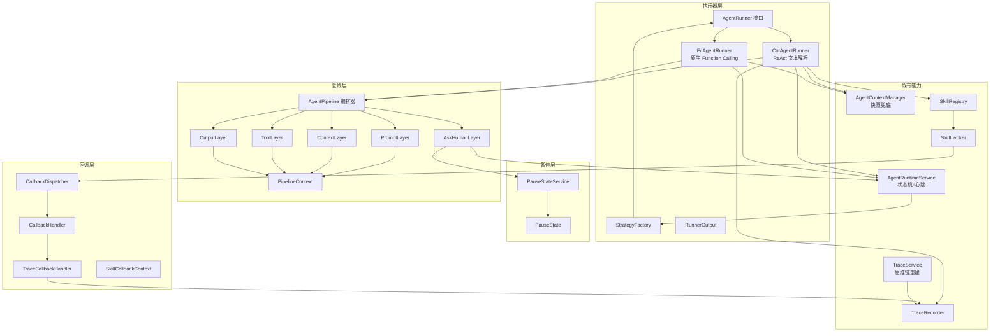

# Design - add-agent-runner-pipeline

> Agent 执行器策略化 + 分层管线 + 轻量暂停 + 统一回调 设计文档。基于 `add-agent-runtime` 的 ReactEngine 改造。

## 1. 模块依赖图



## 2. 包结构（新增 / 改造）

```
com.ai.api.agent
├── runner/                       # 新增：执行器策略化
│   ├── AgentRunner.java          # 统一抽象 run/step/pause/resume
│   ├── AgentStrategy.java        # enum COT / FC
│   ├── StepResult.java           # enum CONTINUE / DONE / PAUSED
│   ├── RunnerOutput.java         # 统一输出模型
│   ├── StrategyFactory.java      # 策略→Runner 动态路由
│   ├── CotAgentRunner.java       # 原 ReactEngine 改造
│   ├── FcAgentRunner.java        # 原生 Function Calling
│   └── SkillToolCallback.java    # Skill → ToolCallback 包装
├── pipeline/                     # 新增：分层管线
│   ├── Layer.java                # Phase(REQUEST/RESPONSE) + order + process
│   ├── AgentPipeline.java        # 编排器（按 phase 分组、按 order 排序）
│   ├── PipelineContext.java      # 统一上下文对象
│   ├── PromptLayer.java
│   ├── ContextLayer.java
│   ├── ToolLayer.java
│   ├── OutputLayer.java
│   └── AskHumanLayer.java
├── pause/                        # 新增：轻量暂停
│   ├── PauseState.java
│   ├── PauseStateMapper.java
│   └── PauseStateService.java
├── callback/                     # 新增：统一回调
│   ├── CallbackHandler.java
│   ├── CallbackDispatcher.java
│   ├── CallbackEvent.java
│   ├── SkillCallbackContext.java
│   └── TraceCallbackHandler.java
├── skill/                        # 改造
│   ├── SkillInvoker.java         # 集成回调埋点
│   └── SkillRegistry.java        # invoke(runtimeId, stepIndex, ...) 重载
├── runtime/                      # 改造
│   ├── AgentRuntimeService.java  # 适配 PauseState + strategy
│   └── AgentTaskConsumer.java    # StrategyFactory 路由
├── trace/                        # 改造
│   └── TraceService.java         # rebuildChain + 分页
├── controller/                   # 改造
│   └── TraceController.java      # GET /chain 接口
└── react/                        # 删除
    └── ReactEngine.java          # 已由 CotAgentRunner 取代
```

## 3. 数据库表结构

迁移脚本：`api/src/main/resources/db/migration/V20260922__add_agent_pause_strategy.sql`

```sql
-- 1. agent_runtime 新增执行策略字段
ALTER TABLE agent_runtime
    ADD COLUMN strategy VARCHAR(20) NOT NULL DEFAULT 'COT'
        COMMENT '执行策略：COT | FC' AFTER agent_config_id;

-- 2. agent_pause_state：轻量暂停点
CREATE TABLE agent_pause_state (
    id BIGINT PRIMARY KEY AUTO_INCREMENT,
    runtime_id BIGINT NOT NULL,
    next_step_index INT NOT NULL,
    pause_type VARCHAR(20) NOT NULL COMMENT 'NORMAL | ASK_HUMAN',
    question VARCHAR(500),
    variables JSON,
    reply TEXT,
    status VARCHAR(20) NOT NULL DEFAULT 'WAITING',
    create_time DATETIME NOT NULL DEFAULT CURRENT_TIMESTAMP,
    update_time DATETIME NOT NULL DEFAULT CURRENT_TIMESTAMP ON UPDATE CURRENT_TIMESTAMP,
    INDEX idx_runtime_status (runtime_id, status)
) COMMENT='Agent 暂停状态';

-- 3. agent_trace 唯一键升级（同一步多类型）
ALTER TABLE agent_trace DROP INDEX uk_runtime_step;
ALTER TABLE agent_trace
    ADD UNIQUE KEY uk_runtime_step_type (runtime_id, step_index, step_type);
```

## 4. 关键设计决策

### D1: 执行策略抽象 — 接口自声明 + 工厂路由

不引入策略模式的重量级容器，`AgentRunner` 接口自带 `strategy()` 自声明，`StrategyFactory` 启动时收集所有 Runner 构建 `EnumMap<AgentStrategy, AgentRunner>`，运行时按 `agent_runtime.strategy` 一行解析路由。

**权衡**：放弃热加载 Runner（新增策略需重启），换取实现最简单、注册自动（新 Runner 加 `@Component` 即生效）。策略字段落库支持按 runtime 维度灵活切换。

### D2: 管线分两层相位（REQUEST / RESPONSE），不引入责任链状态机

对标 Dify AgentPipeline 的分层组合，本实现收敛为两个 Phase：REQUEST（模型调用前：暂停检测→上下文注入→工具注册→提示词组装）与 RESPONSE（模型调用后：输出解析/校验）。Layer 通过 `order()` 排序保证执行顺序稳定，PipelineContext 为唯一数据载体。

**权衡**：Dify 支持运行期动态改管线拓扑；本实现为**编译期静态组合**（Spring 自动收集），换取确定性与可测试性。每层可独立替换实现（自定义 Layer 实现 `Layer` 接口并 `@Component` 即可）。

### D3: 暂停恢复 — 轻量 PauseState 优先，全量快照兜底

暂停不再走全量快照序列化：`agent_pause_state` 只存 `nextStepIndex + pauseType + variables + reply`，恢复时人工回复回填 `observations["ask_human_response"]`，从 nextStepIndex 续跑。全量快照（AgentContextManager）仅用于异常崩溃的完整恢复。

**权衡**：PauseState 无法承载超长上下文（崩溃恢复仍需快照），换取暂停/恢复毫秒级开销与跨重启可恢复性。暂停点与快照并存，职责分离。

### D4: 回调管线 — 同步广播 + 处理器异常隔离

`CallbackDispatcher` 遍历所有 `CallbackHandler` 同步广播事件，单处理器异常捕获后仅告警，不影响 Skill 主流程。`TraceCallbackHandler` 是内置实现，自动对接 TraceRecorder 落库。

**权衡**：放弃异步批量（回调对主流程有毫秒级开销），换取回调时序确定、实现简单。监控/告警类自定义处理器可在内部自行异步化。

### D5: FC 策略工具循环托管给 ChatClient

FcAgentRunner 不实现 ReAct 循环：通过 `ChatClient.prompt().tools(toolCallbacks)` 将 Skill 包装为原生 ToolCallback，工具循环（模型发调用→执行→回填→再推理）由 Spring AI ChatClient 内部托管，模型最终输出即答案。

**权衡**：放弃步内粒度控制（无法暂停在工具调用中途），换取原生 Function Calling 的鲁棒性（无正则解析、参数由模型按 schema 生成）。暂停为整体级 PauseState。

### D6: trace 唯一键升级

原 `(runtime_id, step_index)` 唯一键在"同一步同时存在 thought/action/observation"时必然冲突。升级为 `(runtime_id, step_index, step_type)` 后，思维链重建（groupByStep）可按 step 聚合多类型记录。

## 5. 对外暴露接口（Controller 层新增/变更）

| Method | Path | 功能 |
|--------|------|------|
| POST | `/api/v1/agent/runtime` | 创建 runtime（新增 `strategy` 参数，默认 COT） |
| POST | `/api/v1/agent/runtime/{id}/pause` | 暂停（落 PauseState NORMAL） |
| POST | `/api/v1/agent/runtime/{id}/resume` | 恢复（从 nextStepIndex 续跑） |
| POST | `/api/v1/agent/runtime/{id}/ask-human` | 人工介入（生成 ASK_HUMAN 暂停点） |
| POST | `/api/v1/agent/runtime/{id}/respond` | 人工回复（回填上下文并续跑） |
| GET | `/api/v1/agent/trace/{runtimeId}/chain` | 思维链重建（`page`/`size` 可选分页） |
| GET | `/api/v1/agent/trace/{runtimeId}/replay` | Trace 时间轴回放（沿用） |
| GET | `/api/v1/agent/trace/{runtimeId}/metrics` | 成本汇总（沿用） |

## 6. 与现有模块集成点

- **AgentRuntimeService**：`createRuntime` 增加 `strategy` 参数；`pause/resume` 对接 PauseStateService；新增 `askHuman/respond`；心跳跳过 PAUSED 状态
- **AgentTaskConsumer**：`resolveRunner(runtimeId)` 按 `runtime.strategy` 经 StrategyFactory 选择 Runner
- **AgentContextManager**：保留完整快照能力，作为崩溃恢复兜底（ContextLayer 加载上下文）
- **SkillRegistry / SkillInvoker**：新增带 runtimeId/stepIndex 的 invoke 重载，回调自动落 trace；DagEngine / PlanAndExecuteEngine 同步切换新重载
- **TraceService / TraceController**：新增思维链重建与分页端点

## 7. 异常码扩展

`ErrorCode.java` 新增：

```java
AGENT_STRATEGY_NOT_SUPPORTED("632", "agent strategy not supported"),
AGENT_PAUSE_NOT_FOUND("633", "no active pause state"),
AGENT_PAUSE_ALREADY_EXISTS("634", "pause state already exists"),
```

## 8. 验证策略

- **单元测试**：StrategyFactory 策略映射 / OutputLayer JSON 解析 / PauseStateService 生命周期 / TraceService 思维链聚合
- **集成测试**：COT 与 FC 两种策略端到端（mock ChatClient）；pause→respond→resume 断点续跑
- **手测脚本**：`docs/dev-log/2026-09-08.md` 记录 curl 覆盖 strategy 创建 / pause / ask-human / respond / chain 查询
