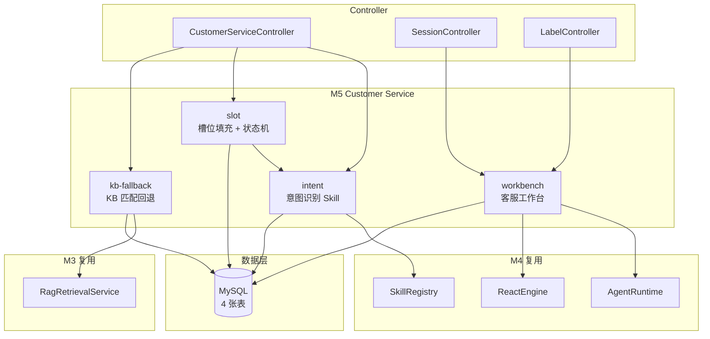

# Design - add-customer-service

> 智能客服模块设计文档。本文档描述 4 个子模块的架构、模块依赖、关键决策与权衡。

## 1. 模块依赖图



## 2. 包结构

```
com.ai.api.cs
├── controller
│   ├── CustomerServiceController.java  # 入口：处理用户消息
│   ├── SessionController.java          # 会话列表 + 接管
│   └── LabelController.java            # 标注回流
├── intent
│   ├── IntentClassifierSkill.java      # @Skill(type=local)
│   ├── IntentRegistry.java              # 启动时初始化 cs_intent
│   └── IntentResult.java                # {intent, confidence, slots_needed}
├── slot
│   ├── SlotFillerSkill.java            # @Skill(type=local)
│   ├── DialogStateMachine.java          # collecting → confirming → executing → done
│   ├── ClarifyTemplateRenderer.java    # cs_clarify_template 渲染
│   └── DialogState.java                # {runtimeId, intent, slots, state}
├── kb
│   ├── KbFallbackService.java          # 调 RRS + 阈值判断
│   └── KbHitLogRecorder.java           # 写 cs_kb_hit_log
├── workbench
│   ├── SessionService.java             # 列表 + 接管
│   └── LabelService.java               # 标注回流
├── entity
│   ├── CsIntent.java
│   ├── CsDialogState.java
│   ├── CsKbHitLog.java
│   ├── CsLabel.java
│   └── CsSession.java
├── mapper
│   ├── CsIntentMapper.java
│   ├── CsDialogStateMapper.java
│   ├── CsKbHitLogMapper.java
│   ├── CsLabelMapper.java
│   └── CsSessionMapper.java
└── config
    └── CustomerServiceProperties.java  # cs.* 配置
```

## 3. 数据库表

```sql
-- 意图注册表
CREATE TABLE cs_intent (
  id BIGINT PRIMARY KEY AUTO_INCREMENT,
  name VARCHAR(64) NOT NULL UNIQUE,
  description VARCHAR(255),
  slots_schema JSON,
  fallback_intent VARCHAR(64) DEFAULT 'small_talk',
  enabled TINYINT DEFAULT 1,
  created_at DATETIME DEFAULT CURRENT_TIMESTAMP
);

-- 对话状态
CREATE TABLE cs_dialog_state (
  id BIGINT PRIMARY KEY AUTO_INCREMENT,
  runtime_id BIGINT NOT NULL,
  session_id BIGINT NOT NULL,
  intent VARCHAR(64) NOT NULL,
  slots JSON,
  state VARCHAR(32) DEFAULT 'collecting',
  clarify_rounds INT DEFAULT 0,
  fallback_triggered TINYINT DEFAULT 0,
  created_at DATETIME DEFAULT CURRENT_TIMESTAMP,
  updated_at DATETIME DEFAULT CURRENT_TIMESTAMP ON UPDATE CURRENT_TIMESTAMP,
  INDEX idx_session (session_id),
  INDEX idx_runtime (runtime_id)
);

-- KB 命中日志
CREATE TABLE cs_kb_hit_log (
  id BIGINT PRIMARY KEY AUTO_INCREMENT,
  runtime_id BIGINT NOT NULL,
  hit_query VARCHAR(512),
  kb_id BIGINT,
  doc_id VARCHAR(128),
  score DECIMAL(5,4),
  hit TINYINT,
  created_at DATETIME DEFAULT CURRENT_TIMESTAMP,
  INDEX idx_runtime (runtime_id),
  INDEX idx_created (created_at)
);

-- 标注回流
CREATE TABLE cs_label (
  id BIGINT PRIMARY KEY AUTO_INCREMENT,
  session_id BIGINT NOT NULL,
  label_type VARCHAR(16) NOT NULL,
  label_content TEXT,
  labeler_id BIGINT NOT NULL,
  created_at DATETIME DEFAULT CURRENT_TIMESTAMP,
  INDEX idx_session (session_id)
);

-- 会话表（复用 chat_session 扩展 status/assigned_to，新增独立表避免污染原表）
CREATE TABLE cs_session (
  id BIGINT PRIMARY KEY AUTO_INCREMENT,
  session_id BIGINT NOT NULL UNIQUE,
  runtime_id BIGINT,
  status VARCHAR(16) DEFAULT 'ai',
  assigned_to BIGINT,
  created_at DATETIME DEFAULT CURRENT_TIMESTAMP,
  updated_at DATETIME DEFAULT CURRENT_TIMESTAMP ON UPDATE CURRENT_TIMESTAMP,
  INDEX idx_status (status),
  INDEX idx_assigned (assigned_to)
);

-- 澄清话术模板
CREATE TABLE cs_clarify_template (
  id BIGINT PRIMARY KEY AUTO_INCREMENT,
  intent VARCHAR(64) NOT NULL,
  slot_name VARCHAR(64) NOT NULL,
  template VARCHAR(512) NOT NULL,
  UNIQUE KEY uk_intent_slot (intent, slot_name)
);
```

## 4. 关键决策

### 4.1 意图识别用 LLM 还是规则

- **选择**：LLM 为主 + 规则兜底（高置信度关键词直接命中，跳过 LLM）
- **权衡**：LLM 准确率高但有延迟与成本，规则响应快但维护成本高
- **实现**：先跑关键词规则（命中即返回 confidence=1.0），未命中再调 LLM

### 4.2 槽位填充用 LLM 还是 NLU

- **选择**：LLM + 结构化输出（JSON Schema 约束）
- **权衡**：LLM 灵活但稳定性差，结构化输出能强制 JSON 格式
- **实现**：调用 ChatClient 时附加 `response_format=json_schema`，解析失败重试一次

### 4.3 KB 回退阈值

- **选择**：0.85（可配）
- **权衡**：阈值高命中少但准确，阈值低命中多但可能误导
- **实现**：`cs.kb-hit-threshold` 配置项，运营按周复盘调优

### 4.4 接管如何停止 ReactEngine

- **选择**：runtime 转 `paused`，ReactEngine 循环每步检查状态
- **权衡**：不强制 kill 线程，让循环自然结束，避免资源泄露
- **实现**：`AgentRuntimeService.transitTo(session.runtimeId, PAUSED)` + 前端切换为人工输入

## 5. 配置项

```yaml
cs:
  intent-confidence-threshold: 0.6
  kb-hit-threshold: 0.85
  clarify-max-rounds: 3
  fallback-intent: small_talk
```
