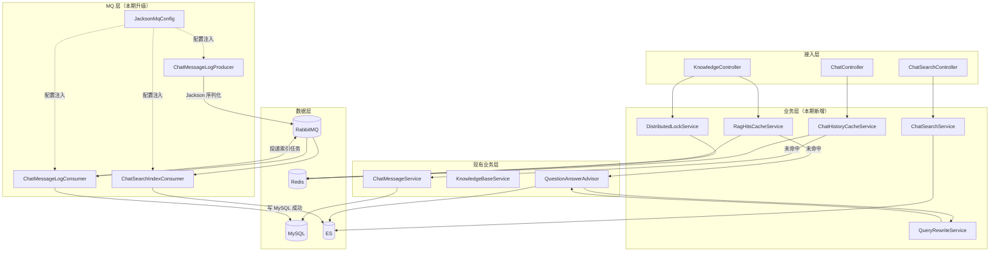

## Context

P0/P1 阶段已落地 ChatStreamService、ChatMessageLogConsumer、KnowledgeBaseService、QuestionAnswerAdvisor 等核心能力。当前直连 MySQL / ES 的查询链路在高并发场景下压力陡增；对话历史 MySQL 单写无法跨会话检索；RAG 召回对长问句敏感；MQ 手写 JSON 拼接存在序列化隐患。

本期在不动表结构、不破坏现有 OpenSpec change（`add-chat-module`、`add-rag-module`）的前提下，新增 4 个横向能力模块，与现有模块以装饰器 / 切面方式集成。

## Goals / Non-Goals

**Goals:**
- 4 个新模块独立打包，便于灰度与回滚
- 缓存层与分布式锁以切面 / 装饰器形式介入，不侵入原 Service 主流程
- 双写、重写、序列化升级均保证失败可降级，不阻塞主流程
- 前端全局搜索入口与现有对话页解耦，独立组件

**Non-Goals:**
- 不引入多级缓存（Caffeine 本地缓存）—— 留待 V2
- 不实现 RAG 语义缓存（query 语义相似度匹配）—— 本期仅精确 hash
- 不做对话历史 ES 全文检索高级分词调优 —— 用默认 IK
- 不做 Query 重写 A/B 测试框架 —— 留待 P3 评测

## Decisions

### Decision 1: 缓存层用 Spring Cache + 自定义 RedisTemplate

**选择**：基于 `RedisTemplate<String, Object>` + `Jackson2JsonRedisSerializer` 自实现轻量缓存服务，而非 Spring Cache 注解。

**理由**：
- Spring Cache 注解难以精细控制「未命中回源并回填」「写入时失效」的语义边界
- 业务侧需要自定义 Key 命名与 TTL（1h / 5min 不同档）
- 现有 `RedisConfig` 已配置 `RedisTemplate`，复用即可

**替代方案**：Spring Cache 注解（放弃，灵活性不足）；Redisson 分布式缓存（过重）

### Decision 2: 分布式锁用 Redisson 而非自实现 SET NX

**选择**：引入 `redisson-spring-boot-starter`，使用 `RLock` 与 watchdog 机制。

**理由**：
- watchdog 自动续期避免业务执行慢于 TTL 导致锁误释放
- 内置可重入、公平锁、读写锁等，未来扩展方便
- 自实现 SET NX + Lua 续期在生产场景易出错

**替代方案**：Redis SET NX EX（放弃，需手写续期与异常处理）；Zookeeper（过重，无必要）

### Decision 3: ES 双写走 RabbitMQ 异步而非应用线程内异步

**选择**：`ChatMessageLogConsumer` 写 MySQL 成功后，向 `chat.search.index` 队列投递索引任务，由独立 Consumer 异步写 ES。

**理由**：
- 与应用线程解耦，ES 抖动不影响主流程响应耗时
- 复用现有 RabbitMQ 基础设施与死信机制
- 索引任务可重试、可观测、可堆积

**替代方案**：`@Async` 应用线程（放弃，ES 抖动会拖垮线程池）；同步双写（放弃，影响主流程耗时）

### Decision 4: Query 重写调用 DeepSeek 轻量模型 + Ollama fallback

**选择**：默认走 DeepSeek API（已有配置），失败时 fallback 到本地 Ollama Qwen2.5。

**理由**：
- DeepSeek 调用成本低、质量稳定
- 本地 Ollama 保证 LLM 不可达时仍可用
- 复用现有 `ModelRouter` 路由能力，无需新建客户端

**替代方案**：仅用 DeepSeek（放弃，无降级风险）；本地 Ollama 默认（放弃，质量略低）

### Decision 5: Jackson 全局 MessageConverter 而非各 Producer 自序列化

**选择**：注册全局 `Jackson2JsonMessageConverter` Bean，自动应用到所有 `RabbitTemplate` 与 `@RabbitListener`。

**理由**：
- 一次配置全局生效，避免每个 Producer / Consumer 各自序列化的不一致
- 支持泛型反序列化与 POJO 直接映射，代码更简洁
- 现有手写拼接逻辑可一次性替换

**替代方案**：各 Producer 自序列化（放弃，易产生不一致）

## Risks / Trade-offs

### Risk 1: Redis 缓存与 MySQL 数据一致性

**场景**：双写失败时 ES 已写、MySQL 未写，或反向情况。

**缓解**：
- 所有缓存 Key 在写入消息时主动失效（Cache-Aside Pattern）
- 失效失败降级为 TTL 自然过期（1h / 5min）
- 关键场景（消息写入）使用事务消息或最终一致性兜底

### Risk 2: Query 重写引入额外延迟

**场景**：LLM 调用平均 500ms-1s，叠加在 RAG 主流程上影响响应时长。

**缓解**：
- LLM 调用走 `Schedulers.boundedElastic` 异步并行
- query 长度 < 6 字符直接跳过重写
- LLM 超时 3s 自动降级使用原 query 单路检索
- 后续可缓存重写结果（query → 改写后 list）

### Risk 3: Redisson 依赖增加运维复杂度

**场景**：Redis 集群模式下 Redisson 配置不当可能导致锁失效。

**缓解**：
- 初期单 Redis 实例，配置 `single-server-config`
- 集群演进时统一评估 Redisson 集群模式配置
- 锁 TTL 设置合理上限（30s），watchdog 兜底

### Risk 4: ES 双写消息堆积

**场景**：ES 持续不可用时 `chat.search.index` 队列堆积。

**缓解**：
- 队列设置最大长度上限（10000），超出告警
- 死信队列 `chat.search.index.dlq` 接收失败消息
- ES 恢复后通过管理接口重放死信

## 模块依赖图



## 对外暴露接口（Controller 层）

### 新增接口

| 方法 | 路径 | 说明 |
|------|------|------|
| GET | `/api/v1/chat/search` | 全局对话历史检索，参数 `q` / `page` / `size` |

### 修改接口（无新增端点，行为变更）

| 方法 | 路径 | 行为变更 |
|------|------|----------|
| GET | `/api/v1/chat/sessions/{sessionId}/messages` | 内部新增 Redis 缓存层，对外响应无变化 |
| POST | `/api/v1/knowledge/{kbId}/documents/upload` | 内部新增 Redisson 锁，并发时返回 409 |
| POST | `/api/v1/chat/sessions/{sessionId}/messages` | 内部触发 RAG 时走 Query 重写 + RRF 融合，SSE 输出无变化 |

## 与现有模块的集成点

| 集成点 | 模块 | 集成方式 |
|--------|------|----------|
| 会话历史读取 | `ChatMessageService.getMessages` | 在 `ChatMessageService` 包装层调用 `ChatHistoryCacheService`，未命中时回源原方法 |
| 消息写入后失效 | `ChatMessageLogConsumer.handleMessageLog` | 写 MySQL 成功后调用 `chatHistoryCacheService.evict(sessionId)` |
| RAG 检索入口 | `ChatStreamService` 中构建 `QuestionAnswerAdvisor` | 在调用前先走 `QueryRewriteService.rewrite`，对多路 query 并行检索 + RRF 融合 |
| RAG 检索结果缓存 | `KnowledgeBaseService` retrieve 流程 | 入口处先查 `ragHitsCacheService.get(kbId, queryHash)`，命中则短路 |
| 知识库批量导入 | `KnowledgeBaseService.batchImport` | 入口处 `distributedLockService.tryLock("kb:import:" + kbId)` |
| MQ Producer | `ChatMessageLogProducer.sendLog` | 用 `objectMapper.writeValueAsBytes(payload)` 替换 `String.format` |
| MQ Consumer | `ChatMessageLogConsumer.handleMessageLog` | 用 `objectMapper.readTree(payload)` 替换 `split` |

## 数据层结构

### Redis Key 规范

| Key Pattern | Type | TTL | 用途 |
|-------------|------|-----|------|
| `chat:history:{sessionId}` | String (JSON) | 1h | 会话消息列表缓存 |
| `rag:hits:kb:{kbId}:{queryHash}` | String (JSON) | 5min | RAG 检索结果缓存 |
| `lock:kb:import:{kbId}` | Redisson RLock | 30s + watchdog | 批量导入串行化锁 |
| `lock:model:config:{modelId}` | Redisson RLock | 30s + watchdog | 模型配置更新互斥锁 |

### ES 新增索引

```json
// chat_message_log 索引 mapping
{
  "mappings": {
    "properties": {
      "messageId": { "type": "keyword" },
      "sessionId": { "type": "keyword" },
      "userId": { "type": "keyword" },
      "role": { "type": "keyword" },
      "content": { "type": "text", "analyzer": "ik_smart" },
      "modelId": { "type": "keyword" },
      "createTime": { "type": "date", "format": "strict_epoch_millis||yyyy-MM-dd HH:mm:ss" }
    }
  },
  "settings": {
    "number_of_shards": 1,
    "number_of_replicas": 1
  }
}
```

### RabbitMQ 新增队列

| 队列 | Exchange | Routing Key | DLX | 用途 |
|------|----------|-------------|-----|------|
| `chat.search.index` | `chat.search` (topic) | `chat.search.index` | `chat.search.index.dlq` | ES 索引任务异步处理 |
| `chat.search.index.dlq` | - | - | - | 索引失败死信队列 |

### application-dev.yml 新增配置

```yaml
spring:
  data:
    redis:
      # 现有配置不变

# 新增 Redisson 配置
redisson:
  config: |
    singleServerConfig:
      address: "redis://${REDIS_HOST}:${REDIS_PORT}"
      password: "${REDIS_PASSWORD}"
      database: 0

# 新增缓存 TTL
cache:
  chat:
    history-ttl: 1h
  rag:
    hits-ttl: 5m
    hits-max-size: 1000

# 新增 ES 索引
elasticsearch:
  indices:
    chat-message-log: chat_message_log

# 新增 Query 重写 LLM 配置
rag:
  query-rewrite:
    enabled: true
    model: deepseek
    fallback-model: ollama-qwen25
    timeout-ms: 3000
    max-tokens: 200
    min-query-length: 6
    rrf-k: 60
```

## Open Questions

无（本期决策已明确，所有取舍在 Risks 中记录）。
