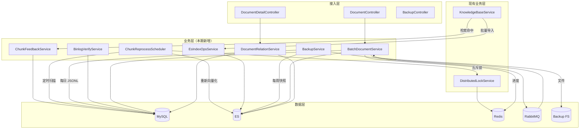

## Context

P2 阶段（add-p2-cache-search-rewrite）落地后会话历史、RAG 召回、MQ 链路与全局检索已闭环，ES 已有 `chat_message_log` 索引、Query 重写、Redis 缓存、Jackson MQ 等基础设施。本期在此基础上构建长期反馈闭环、容量规划、容灾备份、文档管理增强与对话体验打磨。

## Goals / Non-Goals

**Goals:**
- RAG 反馈闭环通过异步计数与定时任务实现，不阻塞主流程
- ES 索引操作服务可复用，支持按场景动态调整 refresh_interval 与分片
- 容灾体系本地文件 + ES snapshot repo，无强依赖云存储
- 文档管理批量操作通过异步队列处理，接口快速返回
- 会话列表修复以最小代码改动完成，不重构 store

**Non-Goals:**
- 不搭建 RAG 自动化评测流水线
- 不做 ES 跨集群灾备（CCSR）
- 不做 MySQL 主从复制与切换
- 不实现文档版本管理
- 不引入新存储引擎

## Decisions

### Decision 1: 命中计数用 MySQL 自增字段而非 Redis

**选择**：直接在 MySQL `knowledge_chunk.hit_count` 字段上 `UPDATE ... SET hit_count = hit_count + 1`，异步线程内执行。

**理由**：
- 命中计数不需要强实时，MySQL 行锁足够支撑
- Redis 计数需考虑持久化与刷盘时机，复杂度高
- 数据沉淀在 MySQL 便于分析与重处理任务查询

**替代方案**：Redis INCR + 定时刷回 MySQL（放弃，复杂度高，一致性弱）

### Decision 2: 低质分片重处理用 Spring `@Scheduled` + Redisson 锁

**选择**：`@Scheduled(cron = "0 0 2 * * 0")` 触发任务，前置 Redisson 锁 `lock:scheduler:chunk-reprocess` 互斥。

**理由**：
- Spring Scheduling 复用现有 Bean 容器，无需引入 XXL-Job 等调度框架
- Redisson 锁保证多实例部署下任务互斥
- 复用 P2 的 `DistributedLockService`，零新增依赖

**替代方案**：XXL-Job（放弃，过重）；Quartz（放弃，配置复杂）

### Decision 3: ES 快照用文件系统 repository

**选择**：注册 `fs` 类型 snapshot repository，路径 `${backup.es.path}`。

**理由**：
- 单机部署场景足够，无云存储依赖
- 恢复操作简单，通过 ES API 直接调用
- 后续演进到 S3 repository 仅需配置变更，代码零改动

**替代方案**：S3 / Azure blob（放弃，初期无云依赖）

### Decision 4: MySQL 备份用 `mysqldump --result-file` + JSONL 转换

**选择**：调用 `mysqldump` 导出 SQL，再通过 Java 程序读取 SQL 转换为 JSONL；或直接用 JDBC `SELECT *` + `ObjectMapper.writeValue` 流式写 JSONL。

**理由**：
- 直接 JDBC 流式写 JSONL 内存占用低，对大表友好
- 不依赖外部脚本，跨平台（Windows / Linux）部署
- JSONL 格式便于后续迁移到其他存储

**替代方案**：mysqldump SQL 文件（放弃，恢复时需执行 SQL，不够灵活）；Pandas 脚本（放弃，引入 Python 依赖）

### Decision 5: 批量操作异步队列 + 进度查询

**选择**：批量删除/重处理通过 RabbitMQ 投递到 `document.batch.task` 队列，立即返回 `batchId`，前端轮询进度接口。

**理由**：
- 批量操作耗时长，同步阻塞 HTTP 连接影响网关稳定性
- 复用现有 RabbitMQ 与死信机制
- 进度状态存 Redis（`batch:progress:{batchId}`），TTL 1 天

**替代方案**：同步处理（放弃，超时风险）；WebSocket 实时推送进度（放弃，前端实现复杂）

### Decision 6: 会话列表选中态修复用 `fetchSessions` 后锚定

**选择**：在 `chatStore.fetchSessions` 内部，await 完成后主动校验并修正 `currentSessionId`，使计算属性 `currentSession` 不返回 null。

**理由**：
- 最小代码改动，不重构 store 结构
- 计算属性返回值稳定，前端 DOM 不闪烁
- 空列表场景降级返回 null 由前端组件做空状态展示

**替代方案**：在组件层用 v-if 守卫（放弃，治标不治本）；引入 loading 状态（放弃，过度设计）

## Risks / Trade-offs

### Risk 1: MySQL 命中计数并发更新瓶颈

**场景**：热门 chunk 高频命中，`UPDATE hit_count = hit_count + 1` 行锁竞争。

**缓解**：
- 异步批量更新（攒 100 条 / 1s 刷一次）
- 单 chunk 命中频率通常 < 10/s，行锁压力可控
- 后续可演进为 Redis 计数 + 定时刷回

### Risk 2: 重处理任务影响在线检索性能

**场景**：周日重处理大批量 chunk 时 ES 向量化负载高，影响在线检索。

**缓解**：
- 任务在凌晨 02:00 低峰期执行
- 限流：并发重处理线程数 ≤ 2
- 通过 ES bulk API 批量索引，减少单条开销

### Risk 3: 备份文件磁盘占用

**场景**：JSONL 与 ES 快照长期堆积导致磁盘满。

**缓解**：
- JSONL 保留 7 天自动清理
- ES 快照保留 4 周自动清理
- Prometheus 监控磁盘使用率，>80% 告警

### Risk 4: binlog 容量增长

**场景**：row 模式 binlog 占用空间大。

**缓解**：
- `binlog_expire_logs_seconds=604800`（7 天）
- 监控 binlog 总大小，>10GB 告警
- 必要时调整 `binlog_row_image=MINIMAL`（牺牲部分恢复精度）

## 模块依赖图



## 对外暴露接口（Controller 层）

### 新增接口

| 方法 | 路径 | 说明 |
|------|------|------|
| POST | `/api/v1/documents/batch/delete` | 批量删除文档 |
| POST | `/api/v1/documents/batch/reprocess` | 批量重处理文档 |
| GET | `/api/v1/documents/batch/reprocess/status/{batchId}` | 查询批量重处理进度 |
| GET | `/api/v1/documents/{docId}/related-chats` | 获取文档关联问答记录 |
| POST | `/api/v1/ops/backup/run` | 手动触发 MySQL JSONL 备份 |
| POST | `/api/v1/ops/backup/es/snapshot` | 手动触发 ES 快照 |
| POST | `/api/v1/ops/backup/es/restore` | 恢复 ES 快照 |
| GET | `/api/v1/ops/binlog/verify` | 校验 binlog 配置状态 |

### 修改接口（行为变更）

| 方法 | 路径 | 行为变更 |
|------|------|----------|
| POST | `/api/v1/knowledge/{kbId}/documents/upload` | 批量导入时动态调整 ES refresh_interval |
| GET | `/api/v1/documents/{docId}` | 返回结果新增 `relatedChats` 字段 |

## 与现有模块的集成点

| 集成点 | 模块 | 集成方式 |
|--------|------|----------|
| RAG 检索命中 | `KnowledgeBaseService.retrieve` | 返回结果前调用 `chunkFeedbackService.incrHitBatch(chunkIds)` 异步累加 |
| 用户点踩 | `ChatMessageService.thumbDown` | 调用 `chunkFeedbackService.decrHit(chunkId)` |
| 知识库批量导入 | `KnowledgeBaseService.batchImport` | 入口调用 `esIndexOpsService.disableRefresh(index)`，finally 调用 `enableRefresh(index)` |
| 知识库索引创建 | `KnowledgeBaseService.createIndex` | 调用 `esIndexOpsService.createIndexWithShardPlan(kbId, estSizeGB)` |
| 文档删除 | `DocumentService.delete` | 改为批量接口，单删除走批量接口 N=1 |
| 会话列表加载 | `chatStore.fetchSessions` (前端) | await 后调用 `anchorCurrentSession()` 修正选中态 |
| 对话历史筛选 | `GlobalSearch.vue` (前端) | 新增时间范围选择器，调用 search API 传 startTime/endTime |

## 数据层结构

### MySQL 表变更

```sql
-- Flyway V20260901__add_hit_count_to_knowledge_chunk.sql
ALTER TABLE knowledge_chunk
  ADD COLUMN hit_count INT NOT NULL DEFAULT 0 COMMENT '累计命中次数',
  ADD INDEX idx_hit_count_score (hit_count, score);

-- 新增反馈日志表
CREATE TABLE chunk_feedback_log (
  id BIGINT PRIMARY KEY AUTO_INCREMENT,
  chunk_id BIGINT NOT NULL,
  user_id BIGINT NOT NULL,
  feedback_type VARCHAR(20) NOT NULL COMMENT 'positive/negative',
  create_time DATETIME NOT NULL DEFAULT CURRENT_TIMESTAMP,
  UNIQUE INDEX uk_user_chunk (user_id, chunk_id, feedback_type),
  INDEX idx_chunk (chunk_id)
) COMMENT='分片反馈日志';

-- 新增重处理日志表
CREATE TABLE chunk_reprocess_log (
  id BIGINT PRIMARY KEY AUTO_INCREMENT,
  chunk_id BIGINT NOT NULL,
  trigger_reason VARCHAR(50) NOT NULL COMMENT 'low_hit / low_score / manual',
  status VARCHAR(20) NOT NULL COMMENT 'success/failed/skipped',
  error_msg TEXT,
  start_time DATETIME NOT NULL,
  end_time DATETIME,
  INDEX idx_chunk (chunk_id),
  INDEX idx_status (status)
) COMMENT='分片重处理日志';
```

### my.cnf 配置变更

```ini
[mysqld]
log_bin=mysql-bin
binlog_format=ROW
binlog_row_image=FULL
binlog_expire_logs_seconds=604800
```

### ES snapshot repository 注册

```json
PUT /_snapshot/kb_backup_repo
{
  "type": "fs",
  "settings": {
    "location": "/data/backup/es/snapshots",
    "compress": true
  }
}
```

### RabbitMQ 新增队列

| 队列 | Exchange | Routing Key | DLX | 用途 |
|------|----------|-------------|-----|------|
| `document.batch.task` | `document.batch` (topic) | `document.batch.task` | `document.batch.task.dlq` | 批量删除/重处理异步任务 |

### Redis Key 规范

| Key Pattern | Type | TTL | 用途 |
|-------------|------|-----|------|
| `batch:progress:{batchId}` | Hash | 1d | 批量任务进度状态 |
| `lock:scheduler:chunk-reprocess` | Redisson RLock | 1h + watchdog | 重处理任务互斥锁 |

### application-dev.yml 新增配置

```yaml
# 定时任务
scheduler:
  chunk-reprocess:
    cron: "0 0 2 * * 0"  # 每周日 02:00
    batch-size: 100
    concurrency: 2

# 备份配置
backup:
  mysql:
    path: /data/backup/mysql/
    retain-days: 7
    cron: "0 0 3 * * ?"  # 每日 03:00
  es:
    path: /data/backup/es/snapshots
    repo-name: kb_backup_repo
    retain-count: 4
    cron: "0 30 2 * * 0"  # 每周日 02:30

# ES 索引操作
elasticsearch:
  index-ops:
    refresh-default: "1s"
    refresh-batch: "-1"
    shard-size-gb: 30
    default-replicas-dev: 1
    default-replicas-prod: 2
```

## Open Questions

无（本期决策已明确，所有取舍在 Risks 中记录）。
