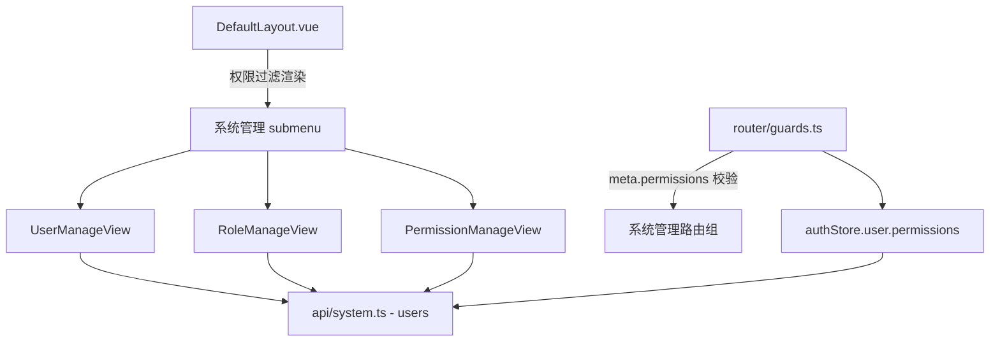

## Context

参见 [proposal.md](./proposal.md) 的 Why 与 What。当前认证体系（`identity/user-auth`）已具备 JWT 认证、CSRF、账户锁定等能力，[JwtAuthenticationFilter](file:///d:/ai/api/src/main/java/com/ai/api/identity/security/JwtAuthenticationFilter.java) 目前对每个请求硬编码注入单一 `ROLE_USER`，[SecurityConfig](file:///d:/ai/api/src/main/java/com/ai/api/identity/config/SecurityConfig.java) 仅做 `anyRequest().authenticated()`，无任何角色/权限维度。前端 [DefaultLayout.vue](file:///d:/ai/ai-agent-web/src/layouts/DefaultLayout.vue) 菜单硬编码，路由无权限守卫。

本项目遵循 MyBatis-Plus DAL、`Result<T>` 统一返回、`@MapperScan("com.ai.api.**.mapper")`、Flyway 迁移、BaseDO 审计+逻辑删除、错误码分段（identity=9xx，`AUTH_FORBIDDEN=941` 已存在且由 `AccessDeniedHandlerImpl` 统一响应）等既定规范。本次 RBAC 全在此基础上增量扩展。

## Goals / Non-Goals

**Goals:**
- 建立「用户-角色-权限」三实体 RBAC 模型与完整的后台管理 REST 接口
- 内置不可删改的超级管理员角色 `SUPER_ADMIN`，自动拥有全部权限点
- 权限加载进认证上下文，配合 Spring Security 方法级 `@PreAuthorize` 做操作级鉴权
- 前端新增「系统管理」菜单（用户/角色/权限三页，标准表格+弹窗 CRUD），菜单与路由按权限动态显隐/拦截
- `GET /users/me` 扩展返回 `roles`、`permissions`

**Non-Goals:**
- 不改造既有业务接口的鉴权（本次仅新增管理能力；业务模块纳入权限管控留待后续 change）
- 不做按钮级指令（`v-permission`）封装，按钮显隐由各管理页对 `permissions` 判断实现
- 不涉及 OAuth2 用户与 RBAC 的绑定策略调整（OAuth 用户同样适用普通角色，自动成为非超管）

## Decisions

### D1 数据模型（4 张表）
采用标准 RBAC 五元组中的四表（用户复用 `sys_user`），关系表用中间关联表承载多对多。

`sys_permission`（权限/资源表）
| 字段 | 类型 | 说明 |
| --- | --- | --- |
| id | BIGINT PK AI | 主键 |
| parent_id | BIGINT | 父级菜单 ID，0=根 |
| code | VARCHAR(64) | 权限编码，如 `system:user:create`，全局唯一 |
| name | VARCHAR(64) | 权限名称 |
| type | TINYINT | 1=菜单，2=操作 |
| path | VARCHAR(255) | 菜单路由路径（type=1 时） |
| icon | VARCHAR(128) | 菜单图标 |
| sort | INT | 排序 |
| status | TINYINT | 1=启用 0=禁用 |
| + BaseDO | | creator/create_time/updater/update_time/deleted |

`sys_role`（角色表）：id、code（唯一，如 `SUPER_ADMIN`）、name、remark、status + BaseDO。
`sys_user_role`（用户-角色关联）：id、user_id、role_id + BaseDO，`uk_user_role(user_id,role_id,deleted)`。
`sys_role_permission`（角色-权限关联）：id、role_id、permission_id + BaseDO，`uk_role_perm(role_id,permission_id,deleted)`。

唯一索引均含 `deleted`，与现有 `sys_user` 一致，避免逻辑删除后无法重建同名记录。

### D2 权限编码与种子数据
权限编码统一 `system:<domain>:<action>`。Flyway 迁移脚本插入内置菜单权限、操作权限及 `SUPER_ADMIN` 角色，并为其全量绑定所有权限点。内置权限点：

| 编码 | 类型 | 说明 |
| --- | --- | --- |
| system:user:menu / system:role:menu / system:permission:menu | 菜单 | 三个管理菜单入口 |
| system:user:create / update / delete / assign | 操作 | 用户管理增改删+分配角色 |
| system:role:create / update / delete / assign | 操作 | 角色管理增改删+分配权限 |
| system:permission:create / update / delete | 操作 | 权限管理增改删 |

### D3 认证上下文携带角色与权限（集成点）
- 扩展 `AuthUserDetails` 为 `record(Long userId, String username, Set<String> roles, Set<String> permissions)`。
- 新增 `RbacPermissionService`，提供 `loadAuthorities(userId)`：查询用户角色与权限（Join `sys_user_role`+`sys_role_permission`），含 `SUPER_ADMIN` 时授予系统中全部权限码（动态，保证新增权限点后超管自动拥有）。
- `JwtAuthenticationFilter` 在认证通过后调用 `loadAuthorities`，构造 `UsernamePasswordAuthenticationToken(principal, null, authorities)`。authorities 同时注入 `ROLE_<code>` 与 `<permCode>`，便于 `@PreAuthorize("hasRole('SUPER_ADMIN')")` 与 `hasAuthority('system:user:delete')` 两种写法。
- **缓存**：`loadAuthorities` 优先读 Redis `rbac:user:perms:{userId}`（TTL 5min），未命中回源 DB；角色/权限/用户角色变更时删除对应键与受影响用户键。

### D4 方法级鉴权
在 [SecurityConfig](file:///d:/ai/api/src/main/java/com/ai/api/identity/config/SecurityConfig.java) 增加 `@EnableMethodSecurity`，各管理接口以 `@PreAuthorize("hasAuthority('system:xxx')")` 声明。无权限抛出 `AccessDeniedException`，由现有 `AccessDeniedHandlerImpl` 统一转为 `AUTH_FORBIDDEN(941)`。路径白名单不变，管理接口仍走 `authenticated()`，具体权限由方法注解收敛。

### D5 统一防止误删/越权校验（服务层）
- 删除角色：校验 `SUPER_ADMIN`（拒绝）、校验 `sys_role_permission` 残留清理、校验 `sys_user_role` 关联清理。
- 删除权限：校验继承性（被操作权限引用时拒绝，见 spec 角色权限删除受保护），校验 `SUPER_ADMIN` 已绑定（超管不绑定，改为动态全授权，故删除普通权限不影响超管）。
- 移除用户角色：禁止移除「最后一名持有 `SUPER_ADMIN` 的用户」的 `SUPER_ADMIN` 角色，保证系统始终保留至少一名超级管理员。

### D6 后端接口清单（Controller 层）

`PermissionController` `/api/v1/permissions`
| 方法 | 路径 | 权限 |
| --- | --- | --- |
| GET | `/api/v1/permissions`（分页/树形，type 过滤） | `system:permission:menu` |
| POST | `/api/v1/permissions` | `system:permission:create` |
| PUT | `/api/v1/permissions/{id}` | `system:permission:update` |
| DELETE | `/api/v1/permissions/{id}` | `system:permission:delete` |

`RoleController` `/api/v1/roles`
| 方法 | 路径 | 权限 |
| --- | --- | --- |
| GET | `/api/v1/roles`（分页） | `system:role:menu` |
| POST | `/api/v1/roles` | `system:role:create` |
| PUT | `/api/v1/roles/{id}` | `system:role:update` |
| DELETE | `/api/v1/roles/{id}` | `system:role:delete` |
| GET | `/api/v1/roles/{id}/permissions` | `system:role:menu` |
| PUT | `/api/v1/roles/{id}/permissions` | `system:role:assign` |

`UserAdminController` `/api/v1/users`（与既有 `GET /users/me` 共存，精确路径无冲突）
| 方法 | 路径 | 权限 |
| --- | --- | --- |
| GET | `/api/v1/users`（分页，支持关键字） | `system:user:menu` |
| POST | `/api/v1/users`（管理员代建用户） | `system:user:create` |
| PUT | `/api/v1/users/{id}`（改资料/状态/重置密码） | `system:user:update` |
| DELETE | `/api/v1/users/{id}`（逻辑删除+清理角色） | `system:user:delete` |
| GET | `/api/v1/users/{id}/roles` | `system:user:menu` |
| PUT | `/api/v1/users/{id}/roles`（分配角色） | `system:user:assign` |

DO 一律转 VO/DTO 对外，不暴露 `password_hash` 等敏感字段。

### D7 前端集成（模块依赖）

- `UserInfo` 增加 `roles: string[]`、`permissions: string[]`。
- 新增 `src/api/system.ts` 封装三组接口。
- 新增 `src/views/system/{UserManageView,RoleManageView,PermissionManageView}.vue`，标准 `el-table`+`el-dialog`+`el-form`。
  - 用户页：搜索+新增+编辑+启停用+删除+「分配角色」弹窗（多选）。
  - 角色页：新增+编辑+删除+「分配权限」弹窗（树形穿梭，按菜单/操作分组）。
  - 权限页：列表（菜单树+操作）、新增/编辑/删除。
- 路由新增 `system/*` 子路由组，`meta.permissions` 声明所需权限；守卫在通过认证后校验命中，不命中则 `ElMessage` 提示并跳回，超管 `permissions` 含全部权限码自然放行。
- 侧边栏「系统管理」以 `el-sub-menu` 承载，其三个子项仅当 `permissions` 命中对应 `xxx:menu` 才渲染。
- 注册用户默认无角色（仅 `ROLE_USER` 基础身份），超管角色由管理员在用户管理中分配。

## Risks / Trade-offs

- [每次请求都查权限，DB 压力]（无缓存实现时） → 引入 Redis 缓存 + 变更失效；`loadAuthorities` 兜底 DB 与回填。
- [权限变更即时性] → 采用 5min TTL 缓存，角色/权限分配操作主动删除缓存键达到近似即时；如需强一致可缩短 TTL。
- [超级角色动态全授权] → 加载时按 `SUPER_ADMIN` 动态授予全部权限码，权限表新增点后超管自动获得，避免「权限集缩减」风险。
- [方法级鉴权遗漏某接口] → 管理接口全部由 `@PreAuthorize` 显式声明，CRUD 权限点与接口一一对应；新增管理接口时补充注解为审查点。
- [`/users/me` 与 `/users` 路径共存] → Spring 精确路径优先，`/me` 与列表 `/users`、`/{id}` 无冲突；测试覆盖确认。
- [删除用户的数据关联] → 采用逻辑删除并连带清理 `sys_user_role`，不物理删行，保留业务可追溯性；禁止删除当前登录用户自身。

## Migration Plan

1. 新增 Flyway `V20260906__add_rbac_tables.sql`：建 4 表 + 插入 `SUPER_ADMIN` 角色、权限种子、角色-权限全量绑定。
2. 后端按 D3/D4/D6 落地实体/Mapper/Service/Controller、错误码、`@EnableMethodSecurity`、扩展 `AuthUserDetails` 与 `JwtAuthenticationFilter`。
3. 前端按 D7 落地 API、三视图、路由与守卫、菜单分组、`UserInfo` 扩展。
4. 启动后端执行 Flyway 迁移与种子数据；前端 `npx vue-tsc` 等构建校验通过。
5. 手工验证：用 `SUPER_ADMIN` 复用既有登录通道登录 → `users/me` 返回全权限 → 可见并进入三个管理页完成 CRUD；新建普通用户 → 不见管理菜单、直接访问被守卫拦截、调用管理接口返回 941。

**回滚**：`@EnableMethodSecurity` 与新增接口无破坏性；Flyway 为追加迁移，不回滚已应用脚本。若需下线 RBAC，移除 `@PreAuthorize` 注解并（可选）删除新表即可，不影响既有认证与业务。

## Open Questions

- 管理员代建用户（POST /users）是否复用既有注册的密码强度要求？—— 采用与注册一致的 BCrypt + 强度校验。
- 是否需要对「角色」增加冻结的并发更新控制？—— 本期角色编辑为整表单覆盖提交，结合乐观锁 `@Version` 即可（MyBatis-Plus 已启用乐观锁插件）。