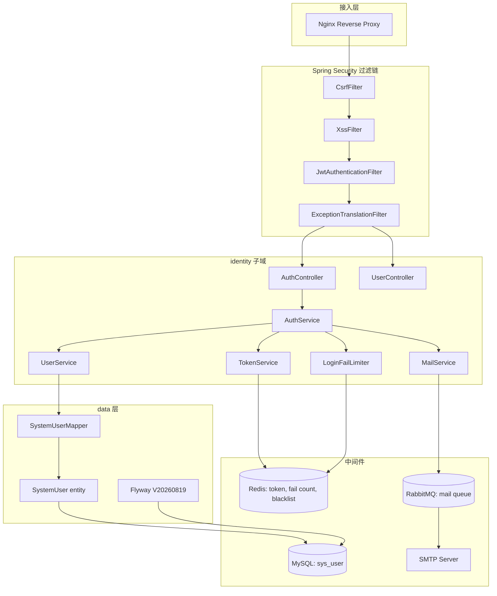

## Context

平台现状（参见 `d:\ai\api` 与 `bootstrap-project` change 产物）已落地 Spring Boot 4.1 + Spring AI 2.0 + MyBatis-Plus 3.5.15 + Flyway + Redis + ES + RabbitMQ，包结构 `com.ai.api.{common,model,data,business}` 已就位。`Result<T>` 统一响应、`GlobalExceptionHandler` 全局异常、`AuditMetaObjectHandler` 审计字段自动填充、`BaseDO` 逻辑删除等基础设施已可用。当前所有 `/api/v1/**` 接口均为匿名访问，无任何认证/授权机制。本设计在此基础上叠加用户认证能力，不破坏既有控制器签名。

## Goals / Non-Goals

**Goals:**
- 建立独立的 `com.ai.api.identity` 子域，与其他业务模块平级，对外提供认证 API
- 实现完整的注册/登录/登出/刷新/忘记密码/重置密码闭环
- 落地 Spring Security 7 + JWT（HS256）认证链路，所有非白名单接口强制鉴权
- 落地登录失败锁定、CSRF 双提交 Cookie、AntiSamy XSS 过滤三大安全防护
- 前端落地三个页面（登录/注册/忘记密码）+ Pinia 鉴权 store + 路由守卫 + axios 拦截器

**Non-Goals:**
- 不实现 OAuth2 第三方登录（GitHub/Google/微信）— 留待后续 `add-oauth2-login` change
- 不实现 RBAC 角色权限模型 — 留待 `add-rbac` change，本次仅做"已认证/未认证"二态
- 不实现多端登录互踢机制 — 单一 refresh token 即可，多端登录在 `add-device-session` change
- 不引入 Spring Session — 使用无状态 JWT，不依赖 HTTP Session
- 不实现验证码（图形/短信/邮件）— 留待 `add-captcha` change，本次仅依赖 BCrypt + 失败锁定防御暴力破解
- 不重构现有 Controller 为统一鉴权适配层 — 现有 `ModelPingController` 通过过滤器统一拦截即可，无需改签名

## Decisions

### D1：JWT HS256 对称加密 vs RS256 非对称加密

**选择**：HS256（HMAC-SHA256，对称密钥）

**理由**：
- 平台为单体应用，签发方与校验方同一进程，无需公钥分发
- HS256 性能比 RS256 快约 10 倍（无 RSA 运算）
- 密钥管理简单，通过 `ai.auth.jwt.secret` 单一配置项即可
- 后续若拆分微服务，可平滑迁移到 RS256（仅替换 `JwtEncoder/Decoder` Bean）

**备选**：RS256（非对称），被否决原因：当前无多服务校验场景，引入密钥对管理增加复杂度。

### D2：Spring Security 7 + 自定义 JwtAuthenticationFilter vs spring-security-oauth2-resource-server

**选择**：自定义 `JwtAuthenticationFilter` 继承 `OncePerRequestFilter`

**理由**：
- OAuth2 Resource Server 默认从 `Authorization: Bearer` 头解析 JWT，但对其过期/黑名单/刷新链路定制成本高
- 自定义过滤器可精准控制：白名单路径跳过、JTI 黑名单查询、`Authentication` 构造、`SecurityContext` 写入
- 学习曲线低，团队对自定义过滤器更熟悉

**备选**：`spring-security-oauth2-resource-server`（`Spring-boot-starter-oauth2-resource-server`），被否决原因：黑名单与刷新旋转逻辑需额外 `JwtDecoder` 包装，定制不如自定义直接。

### D3：BCrypt + 随机盐 vs Argon2id

**选择**：BCrypt（cost=10）

**理由**：
- Spring Security 内置 `BCryptPasswordEncoder`，零额外依赖
- cost=10 在现代 CPU 上单次哈希约 100ms，兼顾安全与性能
- 行业成熟度高，长期使用无破解风险

**备选**：Argon2id（Password Hashing Competition 冠军），被否决原因：需引入 `argon2-jvm` 额外依赖，且对 CPU/内存调参敏感，团队无生产实践。可在后续 `upgrade-password-hasher` change 中迁移（BCrypt 与 Argon2 可通过 `{bcrypt}`/`{argon2}` 前缀共存过渡）。

### D4：Refresh Token 旋转 vs 长期有效

**选择**：Refresh Token 旋转（每次刷新签发新对，旧 refresh 立即黑名单）

**理由**：
- 旋转机制可检测 token 被盗用（旧 token 再次使用触发警报）
- 限制单个 refresh token 的暴露窗口
- OWASP JWT Cheat Sheet 推荐做法

**备选**：Refresh Token 长期有效（不旋转），被否决原因：被盗后无法察觉，旋转成本仅多一次 Redis 写入，可接受。

### D5：CSRF Double-Submit Cookie vs Spring Security CSRF Token Repository

**选择**：Double-Submit Cookie（双重提交 Cookie）

**理由**：
- 前后端分离架构下，SPA 无法优雅处理 Spring Security 默认的 server-side CSRF token
- Double-Submit 模式无服务端状态，水平扩展友好
- 登录成功后由后端写 `csrf-token` Cookie + 返回 token 值给前端存 localStorage，前端在每个非 GET 请求头中携带

**备选**：Spring Security `CookieCsrfTokenRepository`，被否决原因：其默认要求 token 写入 `_csrf` 参数或 `X-CSRF-Token` 头，与前端约定耦合；本次需与 JWT 一起由 axios 拦截器统一注入。

### D6：AntiSamy XSS 过滤 vs JSoup WhiteList

**选择**：AntiSamy（`antisamy-slashdot.xml` policy）

**理由**：
- OWASP 推荐方案，规则维护活跃
- 支持复杂 HTML 场景（如知识库富文本），后续可复用
- 注解 `@XssProtect` 可作用于字段级别，集成 `HandlerInterceptor` 或 `RequestBodyAdvice` 实现

**备选**：JSoup `clean(text, Safelist.none())`，被否决原因：仅适合纯文本场景，富文本扩展性差；且需自行实现 Policy 文件维护。

### D7：忘记密码邮件发送方式

**选择**：`spring-boot-starter-mail` + 异步发送（`@Async` + RabbitMQ 死信队列重试）

**理由**：
- 邮件发送耗时不可控（SMTP 响应 1-5s），同步阻塞登录链路不可接受
- RabbitMQ 已引入，复用现有中间件，无新依赖
- 死信队列保证最终一致性，避免 SMTP 抖动导致邮件丢失

**备选**：同步发送 + 失败重试，被否决原因：用户体验差，邮件服务抖动会传导为接口超时。

## 模块依赖图



## 对外暴露接口

| 接口 | 方法 | 路径 | 鉴权 | CSRF | 用途 |
|------|------|------|------|------|------|
| 注册 | POST | `/api/v1/auth/register` | 匿名 | 豁免 | 用户名+邮箱+密码注册 |
| 登录 | POST | `/api/v1/auth/login` | 匿名 | 豁免 | 邮箱/用户名+密码登录 |
| 刷新 | POST | `/api/v1/auth/refresh` | 匿名 | 校验 | 用 refresh token 换新 token 对 |
| 登出 | POST | `/api/v1/auth/logout` | 已认证 | 校验 | 拉黑当前 access+refresh |
| 忘记密码 | POST | `/api/v1/auth/password/forgot` | 匿名 | 豁免 | 发送重置邮件 |
| 重置密码 | POST | `/api/v1/auth/password/reset` | 匿名 | 校验 | token+新密码重置 |
| 当前用户 | GET | `/api/v1/users/me` | 已认证 | 豁免 | 获取当前登录用户信息 |
| 健康检查 | GET | `/actuator/health` | 匿名 | 豁免 | 探活 |
| API 文档 | GET | `/v3/api-docs/**`、`/swagger-ui/**` | 匿名 | 豁免 | OpenAPI |

## 与现有模块的集成点

1. **`com.ai.api.common.result.Result<T>`**：所有 AuthController 接口返回 `Result<T>`，复用统一响应格式
2. **`com.ai.api.common.exception.GlobalExceptionHandler`**：扩展 `BusinessException` 处理，新增 `AuthException` 子类（401/403/423/409 等业务码）
3. **`com.ai.api.common.exception.ErrorCode`**：新增 `AUTH_*` 段（500-599），与 `MODEL_*`（300-399）、`COMMON_*`（100-199）隔离
4. **`com.ai.api.data.entity.BaseDO`**：`SystemUser` 继承 `BaseDO`，复用审计字段与逻辑删除
5. **`com.ai.api.data.config.MybatisPlusConfig`**：分页插件、乐观锁插件自动作用于 `SystemUserMapper`
6. **`com.ai.api.data.config.AuditMetaObjectHandler`**：注册时自动填充 `creator/updater` 为 "system"（注册场景无登录用户），后续业务场景填充当前 `SecurityContext` 中的用户
7. **`com.ai.api.model.controller.ModelPingController`**：原本匿名访问，本次通过 SecurityFilterChain 统一拦截，无需修改 Controller 代码
8. **`com.ai.api.business.llmlog.LlmLogConsumer`**：消费消息时从 `SecurityContext` 取 userId 填充 `creator` 字段（已登录用户的 LLM 调用日志归属），本次需适配 `JwtAuthenticationFilter` 写入的 `Authentication`

## 数据层结构

### `sys_user` 表 DDL（Flyway `V20260819__create_sys_user.sql`）

```sql
CREATE TABLE `sys_user` (
    `id`              BIGINT       NOT NULL AUTO_INCREMENT COMMENT '主键',
    `username`        VARCHAR(32)  NOT NULL                COMMENT '用户名',
    `email`           VARCHAR(128) NOT NULL                COMMENT '邮箱',
    `password_hash`   VARCHAR(72)  NOT NULL                COMMENT 'BCrypt 哈希',
    `salt`            VARCHAR(32)  NOT NULL                COMMENT '随机盐（BCrypt 内部已含盐，此字段为业务层附加熵）',
    `status`          TINYINT      NOT NULL DEFAULT 1      COMMENT '状态：1=正常, 0=禁用',
    `fail_count`      INT          NOT NULL DEFAULT 0      COMMENT '连续登录失败次数',
    `lock_until`      DATETIME     NULL                    COMMENT '锁定截止时间',
    `last_login_at`   DATETIME     NULL                    COMMENT '最近登录时间',
    -- BaseDO 审计字段
    `creator`         VARCHAR(64)  NOT NULL DEFAULT 'system',
    `create_time`     DATETIME     NOT NULL DEFAULT CURRENT_TIMESTAMP,
    `updater`         VARCHAR(64)  NOT NULL DEFAULT 'system',
    `update_time`     DATETIME     NOT NULL DEFAULT CURRENT_TIMESTAMP ON UPDATE CURRENT_TIMESTAMP,
    `deleted`         TINYINT      NOT NULL DEFAULT 0,
    PRIMARY KEY (`id`),
    UNIQUE KEY `uk_user_username` (`username`, `deleted`),
    UNIQUE KEY `uk_user_email` (`email`, `deleted`)
) ENGINE=InnoDB DEFAULT CHARSET=utf8mb4 COMMENT='系统用户表';
```

### Redis Key 命名空间

| Key 模式 | 类型 | TTL | 用途 |
|---------|------|-----|------|
| `auth:fail:{usernameOrEmail}` | String | 15min | 登录失败计数 |
| `auth:lock:{userId}` | String | 15min | 账户锁定标记（与 DB `lock_until` 字段二选一，采用 DB 字段，Redis 仅加速查询） |
| `auth:refresh:{jti}` | String | 7d | refresh token 白名单（旋转机制下，刷新时删除旧 JTI，写入新 JTI） |
| `auth:access:blacklist:{jti}` | String | 余下有效期 | access token 黑名单（登出时写入） |
| `auth:refresh:blacklist:{jti}` | String | 余下有效期 | refresh token 黑名单（登出/刷新/重置密码时写入） |
| `auth:reset:{token}` | String | 30min | 密码重置 token → userId 映射 |

### RabbitMQ 队列结构

| Exchange | Queue | Routing Key | Dead Letter | 用途 |
|---------|-------|-------------|-------------|------|
| `auth.exchange`（topic） | `auth.mail.reset-password` | `auth.mail.reset-password` | `auth.mail.dlx` | 密码重置邮件发送任务 |

## 前端文件结构

```
ai-agent-web/
├── src/
│   ├── api/
│   │   └── auth.ts                  # 登录/注册/刷新/忘记密码 API
│   ├── stores/
│   │   └── auth.ts                   # Pinia 鉴权 store（token / user state）
│   ├── router/
│   │   ├── index.ts                  # 添加 /login /register /forgot-password 路由
│   │   └── guards.ts                 # 路由守卫（未登录跳转 + 角色占位）
│   ├── views/
│   │   └── auth/
│   │       ├── LoginView.vue        # 登录页（含邮箱/用户名切换）
│   │       ├── RegisterView.vue     # 注册页
│   │       └── ForgotPasswordView.vue # 忘记密码页
│   ├── components/
│   │   └── XssInput.vue             # 输入组件，统一附加 @XssProtect 校验
│   └── api/
│       └── http.ts                  # axios 拦截器附加 Authorization / X-CSRF-Token
```

## 后端包结构

```
com.ai.api.identity/
├── controller/
│   ├── AuthController.java          # /register /login /logout /refresh
│   └── UserController.java         # /users/me
├── service/
│   ├── AuthService.java            # 登录/登出/刷新主流程
│   ├── UserService.java            # 用户 CRUD + 唯一性校验
│   ├── TokenService.java           # JWT 编解码 + JTI 黑名单
│   ├── LoginFailLimiter.java       # 失败计数 + 账户锁定
│   └── MailService.java            # 邮件发送（@Async + RabbitMQ）
├── entity/
│   └── SystemUser.java                # 与 sys_user 表对应
├── repository/
│   └── SystemUserMapper.java          # MyBatis-Plus Mapper
├── dto/
│   ├── RegisterRequestDTO.java
│   ├── LoginRequestDTO.java
│   ├── RefreshRequestDTO.java
│   ├── ForgotPasswordRequestDTO.java
│   ├── ResetPasswordRequestDTO.java
│   └── LoginResponseDTO.java
├── config/
│   ├── SecurityConfig.java         # Spring Security 7 配置
│   └── AuthProperties.java         # ai.auth.* 配置绑定
└── security/
    ├── JwtAuthenticationFilter.java
    ├── CsrfFilter.java             # 自定义 CSRF 过滤器
    ├── XssFilter.java              # AntiSamy XSS 过滤
    ├── AuthEntryPoint.java         # 401 处理
    ├── AccessDeniedHandlerImpl.java # 403 处理
    └── AuthUserDetails.java        # Authentication principal
```

## Risks / Trade-offs

| Risk | Mitigation |
|------|-----------|
| JWT 密钥泄漏后所有 token 可被伪造 | 密钥通过环境变量 `AI_AUTH_JWT_SECRET` 注入，不入仓库；定期轮换机制在 `add-key-rotation` change |
| Refresh token 旋转期间网络抖动导致客户端拿到新 token 但旧 token 已黑名单，旧请求重试失败 | 客户端实现"短时重试窗口"（500ms 内重试同一请求，仅在新 token 下生效），并在 axios 响应拦截器中检测 401 后立即刷新并重放 |
| AntiSamy 性能开销（每次请求清洗） | 仅对带 HTML 字段的接口启用（注册/忘记密码/知识库后续），登录/刷新等纯 token 接口豁免；通过 `@XssProtect` 注解精确控制 |
| 登录失败计数依赖 Redis，Redis 不可用时无法限流 | DB 字段 `fail_count` 与 `lock_until` 作为兜底，Redis 异常时 fallback 到 DB 查询；通过 `RedisUnavailableEvent` 监听切换 |
| `ModelPingController` 由匿名变鉴权后，前端原型页面需同步改造 | 前端 axios 拦截器统一附加 token，原型页面初始化时跳转登录页；通过路由守卫保证 |
| SMTP 服务商限流导致重置邮件丢失 | RabbitMQ 死信队列 + 指数退避重试（1s/5s/30s/2min/10min 共 5 次），全部失败后告警 |

## Migration Plan

1. **准备阶段**：在 `application-dev.yml` 添加 `ai.auth.*` 配置（jwt secret、token TTL、邮件 SMTP、登录失败阈值）；准备 SMTP 测试账号（Mailtrap 或 Gmail App Password）
2. **后端部署**：
   - 应用启动时 Flyway 自动执行 `V20260819__create_sys_user.sql` 建表
   - Spring Security 过滤链生效，所有 `/api/v1/**` 路径要求 token
   - 现有 `ModelPingController` 调用方（前端原型页）需先登录获取 token
3. **前端部署**：
   - 新版本上线后默认跳转 `/login`
   - 用户首次访问需注册账号
4. **回滚策略**：
   - 数据库：`V20260820__rollback_sys_user.sql`（DROP TABLE sys_user）
   - 配置：临时将 `ai.auth.enabled=false` 关闭鉴权（保留代码，仅过滤链生效开关）
   - 前端：回退到上一个 tag

## Open Questions

（无 — 关键决策已在上文确定，剩余细节如 SMTP 服务商选择、密钥具体值等可在实施阶段通过环境变量配置，不影响 specs 与任务分解）
