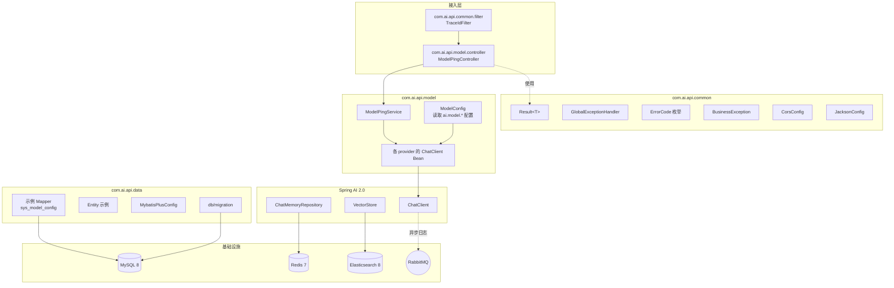

## Context

项目当前存在：
- `d:\ai\api`：Spring Boot 4.1 + Spring AI 2.0 单模块脚手架，根包 `com.ai.api`，已引入 amqp/data-elasticsearch/data-redis/validation/webmvc 与 Spring AI（chat-memory-redis、stability-ai、vector-store-elasticsearch、advisor）依赖，但仅有 `ApiApplication` 启动类与 `application.properties`（仅一行 `spring.application.name=api`）。
- `d:\ai\ai-agent-web`：Vue3 + Vite + Element Plus 前端骨架，已配置 ESLint/oxlint/Prettier，`App.vue` 仅为占位，`router/index.ts` 路由为空。

缺失项见 [proposal.md - Why](./proposal.md)。本 design 解决"如何"补齐脚手架，重点决策包括：MyBatis 作为强制数据访问层（团队要求）、统一响应/异常/TraceId、前后端联调通路、模型调用最小通路。

## Goals / Non-Goals

**Goals:**
- 在不拆分 Maven 多模块的前提下，通过子包组织 `com.ai.api.{common,model,system}`，建立可演进的代码结构
- 落地 MyBatis-Plus + Flyway 作为后续所有业务模块的持久化范式
- 打通前后端联调：Vite 代理 + CORS + 统一响应 + axios 拦截器
- 打通三种模型（DeepSeek/通义千问/Ollama）的最小调用通路（仅 ping 接口）
- 提供健康检查、Swagger、Prometheus 指标端点

**Non-Goals:**
- 不实现完整 `ModelRouter`（路由策略、fallback、限流在后续 `add-model-capability`）
- 不实现业务 Controller/Service/Mapper（仅保留一个 `ModelPingController` 作为示例）
- 不实现 RBAC、JWT 鉴权（在后续 `add-system-management`）
- 不拆分多模块、不引入 Redisson、不配置完整监控告警

## Decisions

### D1: 数据访问层使用 MyBatis-Plus（而非 JPA）

**选择**：MyBatis-Plus 3.5.x 作为数据访问层统一规范。

**理由**：
- 团队强制要求使用 MyBatis
- MyBatis-Plus 在原生 MyBatis 基础上提供单表 CRUD、分页、代码生成、乐观锁等增强
- XML 映射保留对复杂 SQL 的完全控制，便于 RAG/Agent 模块的多表关联查询
- 与 Spring Boot 4.1 兼容性良好（使用 mybatis-plus-spring-boot3-starter）

**备选方案**：
- 原生 MyBatis：缺少单表 CRUD 自动生成，开发效率低
- Spring Data JPA：对复杂 SQL 控制力弱，与团队技术栈不符
- JOOQ：学习成本高，社区资源少

**约束**：
- 所有 Mapper 继承 `BaseMapper<T>`
- 实体使用 `@TableName`、`@TableId(type=IdType.AUTO)`、`@TableField`
- 复杂查询 MUST 写在 XML（位于 `resources/mapper/<module>/`）
- 配置 `MybatisPlusInterceptor`（分页 + 乐观锁）

### D2: 单模块 + 子包组织（不拆分多模块）

**选择**：M0 阶段保持 `d:\ai\api` 单模块，通过子包划分模块边界。

**理由**：
- 现状已是单模块，M0 目标是快速打通通路，避免过早引入多模块复杂度
- 模块边界尚未完全稳定（RAG、Agent 设计可能在迭代中调整）
- 单模块编译快、调试简单

**备选方案**：
- 立即拆分多模块：增加 Maven 父子 POM 维护成本，依赖管理复杂
- 直接使用 Spring Modulith：与团队现有经验不符

**演进触发条件**（在 [architecture.md](file:///d:/ai/docs/architecture.md) §9.1 记录）：
- 编译时间超过 60 秒
- 模块边界稳定且团队规模 ≥ 5 人
- OpenSpec change `refactor-multi-module` 负责后续拆分

### D3: 模块依赖图与包结构



### D4: 对外暴露接口（Controller 层）

| 接口 | 方法 | 路径 | 说明 |
|------|------|------|------|
| 模型连通性测试 | POST | `/api/v1/model/ping` | 入参 `{modelId, prompt}`，返回模型响应 |
| 健康检查 | GET | `/actuator/health` | Spring Boot Actuator 默认 |
| Prometheus 指标 | GET | `/actuator/prometheus` | 供 Prometheus 抓取 |
| Swagger UI | GET | `/swagger-ui.html` | API 文档 |
| OpenAPI JSON | GET | `/v3/api-docs` | OpenAPI 3 规范 |

### D5: 与现有模块/代码的集成点

- **现有 `ApiApplication.java`**：保留为主启动类，添加 `@MapperScan("com.ai.api.**.mapper")` 扫描 Mapper
- **现有 pom.xml**：保留已引入的 Spring AI 依赖；追加 MyBatis-Plus、Flyway、springdoc、actuator、DeepSeek/Qwen/Ollama starter
- **现有 `application.properties`**：删除并替换为 `application.yml` + `application-dev.yml` + `application-prod.yml`
- **现有 `ai-agent-web`**：在 `src/api/` 下新增 `request.ts`、`model.ts`；在 `src/layouts/` 下新增 `DefaultLayout.vue`；在 `src/router/index.ts` 注册路由
- **现有 `ai-agent-web/vite.config.ts`：** 追加 `server.proxy` 配置（`/api`、`/actuator` 代理到 `http://localhost:8080`）

### D6: 数据层结构

#### MySQL 初始表（`V20260818__init.sql`）

```sql
-- 模型配置表（本 change 仅用于演示 MyBatis 通路，完整模型注册在 add-model-capability）
CREATE TABLE sys_model_config (
  id BIGINT PRIMARY KEY AUTO_INCREMENT,
  provider VARCHAR(32) NOT NULL COMMENT 'deepseek/qwen/ollama',
  model_id VARCHAR(64) NOT NULL COMMENT '模型标识，如 deepseek-chat',
  display_name VARCHAR(128),
  api_key VARCHAR(255) COMMENT '实际从环境变量读取，本字段留空',
  base_url VARCHAR(255),
  enabled TINYINT DEFAULT 1,
  created_at DATETIME DEFAULT CURRENT_TIMESTAMP,
  updated_at DATETIME DEFAULT CURRENT_TIMESTAMP ON UPDATE CURRENT_TIMESTAMP,
  deleted TINYINT DEFAULT 0,
  UNIQUE KEY uk_provider_model (provider, model_id)
);

-- LLM 调用日志表（异步写入，打通可观测性基础）
CREATE TABLE sys_llm_log (
  id BIGINT PRIMARY KEY AUTO_INCREMENT,
  trace_id VARCHAR(64) NOT NULL,
  model_id VARCHAR(64) NOT NULL,
  prompt TEXT,
  response TEXT,
  prompt_tokens INT DEFAULT 0,
  completion_tokens INT DEFAULT 0,
  total_tokens INT DEFAULT 0,
  latency_ms INT,
  status VARCHAR(16) COMMENT 'success/failed',
  error_msg TEXT,
  created_at DATETIME DEFAULT CURRENT_TIMESTAMP,
  INDEX idx_trace (trace_id),
  INDEX idx_model_created (model_id, created_at)
);
```

#### 索引说明
- `sys_model_config`：`uk_provider_model` 唯一约束避免重复配置
- `sys_llm_log`：`idx_trace` 支持按 traceId 检索链路；`idx_model_created` 支持按模型与时间范围查询

#### Redis 键策略（本 change 最小集）
| Key | 类型 | TTL | 用途 |
|-----|------|-----|------|
| `model:config:<modelId>` | String(JSON) | 10min | 模型配置缓存（从 DB 加载） |
| `chat:memory:<sessionId>` | Hash | 1h | Spring AI chat-memory-repository-redis 自动管理 |

#### RabbitMQ 队列（本 change 最小集）
| Exchange | 类型 | Queue | Routing Key | 用途 |
|----------|------|-------|-----------|------|
| `ai.llm.log` | direct | `q.llm.log` | `llm.log` | 异步写入 `sys_llm_log` |

#### MyBatis 配置（`application.yml`）
```yaml
mybatis-plus:
  mapper-locations: classpath*:mapper/**/*.xml
  type-aliases-package: com.ai.api.**.entity
  configuration:
    map-underscore-to-camel-case: true
    cache-enabled: true
  global-config:
    db-config:
      id-type: AUTO
      logic-delete-field: deleted
      logic-not-delete-value: 0
      logic-delete-value: 1
```

### D7: 模型配置与 ChatClient 工厂

**配置**（`application.yml`）：
```yaml
ai:
  model:
    deep-seek:
      api-key: ${DEEPSEEK_API_KEY:}
      base-url: https://api.deepseek.com
      model-id: deepseek-chat
    qwen:
      api-key: ${QWEN_API_KEY:}
      base-url: https://dashscope.aliyuncs.com/compatible-mode
      model-id: qwen-plus
    ollama:
      base-url: http://localhost:11434
      model-id: qwen2.5:7b
```

**ChatClient 工厂**：通过 `@Configuration` 为每个 provider 注册独立的 `ChatModel` + `ChatClient` Bean，使用 `@Qualifier("deepSeekChatClient")` 注入。本 change 仅实现"按 modelId 找到对应 ChatClient 并调用"，完整路由在后续扩展。

### D8: 工程规范工具链

- **checkstyle**：`api/checkstyle.xml`，绑定 `validate` 阶段
- **spotless**：格式化 Java 代码，绑定 `compile` 阶段
- **husky + lint-staged**（前端）：提交前自动 `eslint --fix` + `prettier`
- **commitlint**：校验 Conventional Commits 格式

## Risks / Trade-offs

- **[Spring AI 2.0 API 变更风险]** → 缓解：锁定 `spring-ai.version=2.0.0`，封装 `ModelPingService` 适配层，业务代码不直接使用 ChatClient API
- **[Spring Boot 4.1 与 MyBatis-Plus 兼容性]** → 缓解：使用 `mybatis-plus-spring-boot3-starter`（向后兼容），若不兼容降级为原生 MyBatis + PageHelper
- **[Spring AI 2.0 starter 缺失]** → 缓解：DeepSeek/Qwen/Ollama starter 若未发布，使用 OpenAI 兼容模式（DeepSeek/Qwen 均提供 OpenAI 兼容 API）
- **[单模块演进为多模块时的代码迁移成本]** → 缓解：本 change 已按子包组织，迁移时主要是包路径重命名，OpenSpec change `refactor-multi-module` 负责后续拆分
- **[traceId 在异步线程丢失]** → 缓解：`TraceIdFilter` 使用 `TaskDecorator` 将 MDC 传递到 `@Async` 与 RabbitMQ 消费者
- **[API Key 泄露]** → 缓解：所有 Key 通过环境变量注入，`.env` 加入 `.gitignore`，CI 使用 secrets

## Migration Plan

1. **准备**：本地启动 MySQL/Redis/ES/RabbitMQ（见 [deployment.md](file:///d:/ai/docs/deployment.md) Docker Compose）
2. **后端改造**（按 [tasks.md](./tasks.md) 顺序）：
   - 更新 pom.xml 引入新依赖
   - 替换配置文件
   - 实现 common 子包
   - 实现 data 子包（MyBatis 配置 + Flyway + 示例 Mapper）
   - 实现 model 子包（ChatClient 工厂 + ModelPingService）
   - 配置 CORS、Jackson、Actuator、springdoc
3. **前端改造**：
   - 配置 Vite proxy
   - 新增 axios 拦截器
   - 新增基础布局与路由
   - 实现"模型测试"页面
4. **验证**：
   - `mvn spring-boot:run` 启动后端
   - `npm run dev` 启动前端
   - 浏览器访问前端 → 调用 `/api/v1/model/ping` → 显示模型响应
5. **回滚策略**：
   - 后端：`git revert` 提交，恢复 pom.xml 与 application.properties
   - 前端：`git revert` 提交
   - 数据库：Flyway 不自动回滚 DDL，需手动 `DROP TABLE sys_model_config, sys_llm_log`

## Open Questions

- **Ollama 本地模型是否在本 change 启动**：若开发机无 GPU 或未安装 Ollama，`/api/v1/model/ping` 调用 `qwen2.5:7b` 会失败。建议本 change 验证时使用 DeepSeek，Ollama 通路打通但不在验收硬指标中。
- **MyBatis-Plus 与 Spring Boot 4.1 的 starter 版本**：若 `mybatis-plus-spring-boot3-starter` 不兼容 Boot 4，需等待官方支持或降级 Boot 版本。当前假设兼容，实施时若发现不兼容则切回原生 MyBatis（仍满足团队"MyBatis 强制"要求）。
